# 大国崛起

一款原创、开源的现代与近未来题材即时战略游戏。建设基地，争夺情报与资源，用侦察、电子战、陆海空火力和后勤补给完成一场真正需要判断的战斗。当前版本为 **1.1.0 战略威慑更新**，主要面向桌面浏览器。这是走向 2.0 的一次更新，不代表整份路线图已完成。

> 本项目不是《红色警戒》的官方续作，也没有移植其代码、模型、音乐或配音。现实装备名称用于公开资料层的原型介绍；游戏模型、阵营、数值与科幻设定均为原创或游戏化表达，不代表真实军事性能。

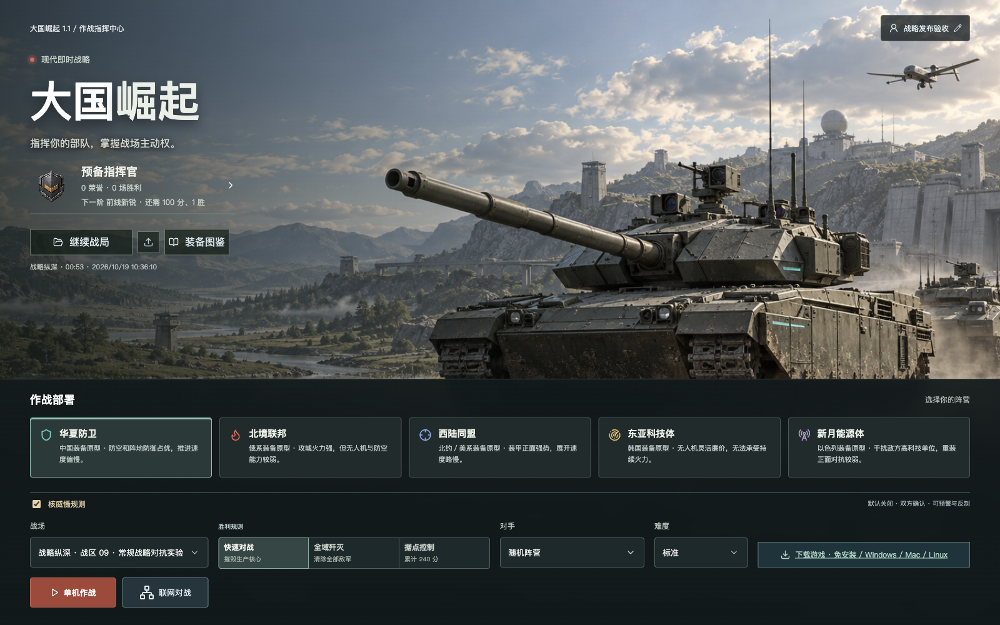

**[在线试玩](https://43.135.186.21:8443/) · [官网下载](https://43.135.186.21:8443/downloads/) · [1.1.0 发行与下载](https://github.com/chencheng666/great-powers-rts/releases/tag/v1.1.0) · [提交建议或问题](https://github.com/chencheng666/great-powers-rts/issues)**

首页背景是原创插画，下方战场与图鉴图片来自游戏实际界面。硅谷服务器可能有延迟；下载慢时可使用 GitHub Release。离线包完整解压后直接打开 `PLAY.html`，无需安装 Node.js；离线包仅支持单机，不包含联机服务器。

## 现在能玩什么

| 内容 | 1.1.0 状态 |
| --- | --- |
| 单机 | 八张双人战区对抗 AI，另有一张六方战区可进行一人对五 AI 的自由对战；新兵、标准、专家三档难度 |
| 战略实验 | 6400×4160 战略纵深、常规弹道编组、武装直升机、异构蜂群、反导和机动反卫星侦察；核规则默认关闭，双人联机需双方明确确认 |
| 联网 | 昵称游客双人房间对战，六位房间码邀请、双方准备、掉线宽限与重连；[六方实验入口](https://43.135.186.21:8443/candidate/)支持真人与 AI 混合席位、淘汰观战 |
| 胜利规则 | 快速对战、全域歼灭、据点控制；六方战区也使用这三种规则 |
| 阵营 | 华夏防卫、北境联邦、西陆同盟、东亚科技体、新月能源体，拥有不同侧重和可反制的特色能力 |
| 成长与资料 | 装备图鉴、三维模型预览、八阶荣誉称号、战后数据复盘；单机战局和荣誉可分别导出备份 |

六方联机仍是**实验战区**：每席最多 40 个单位（含生产队列），当前服务器同时只开放一场六方战局；它不是正式排位或 3v3 天梯。微信登录、匹配和跨设备荣誉同步尚未上线。

## 战场实景

| 陆战与联合兵种 | 海上运输与舰队 |
| --- | --- |
| 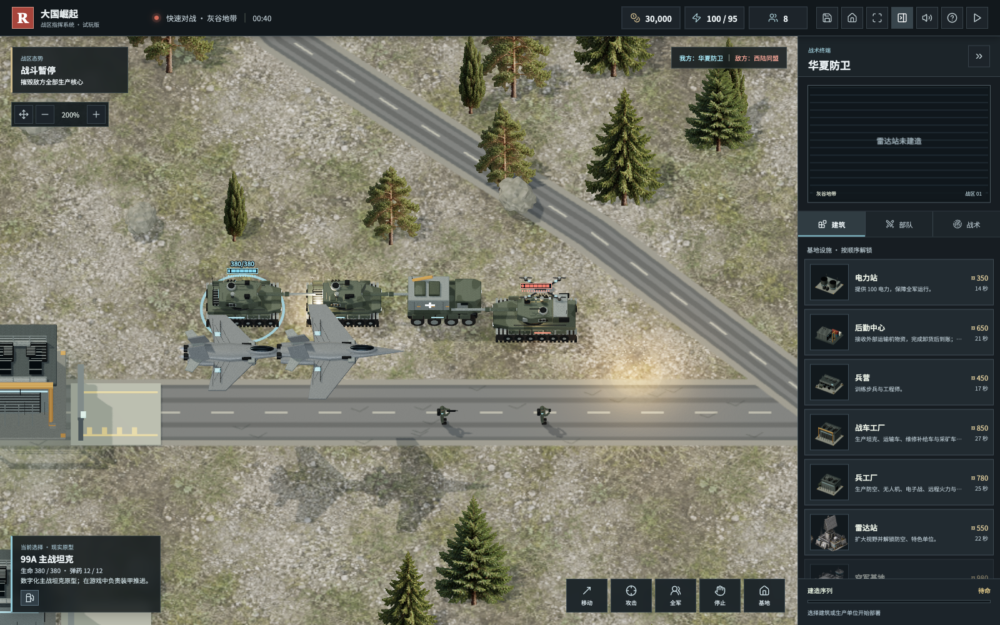 | 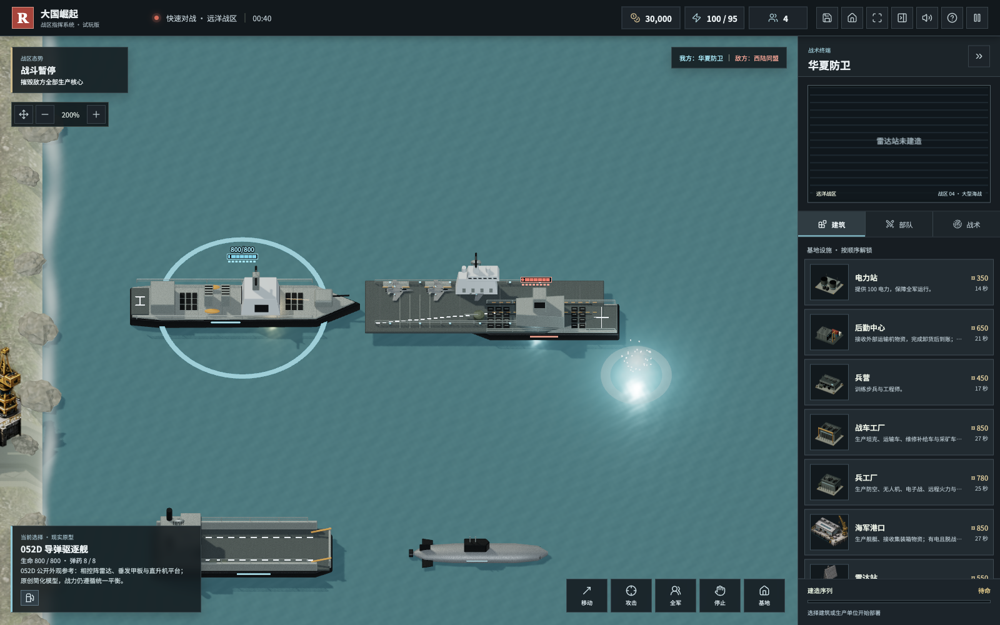 |
| 子午环阵科幻战区 | 六方实验战区 |
| 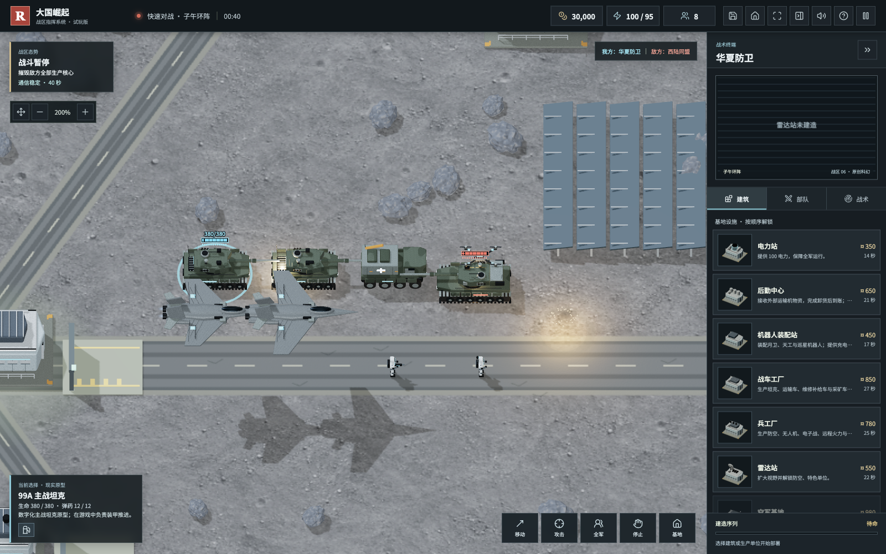 | 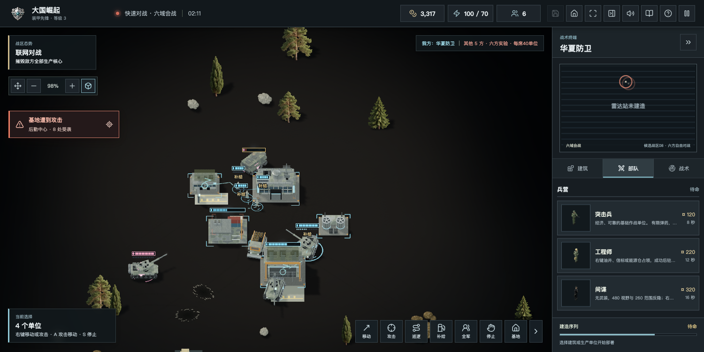 |
| 装备图鉴 | 玩家荣誉 |
| 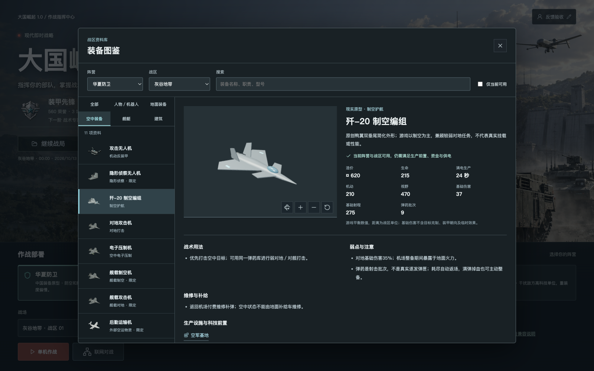 | 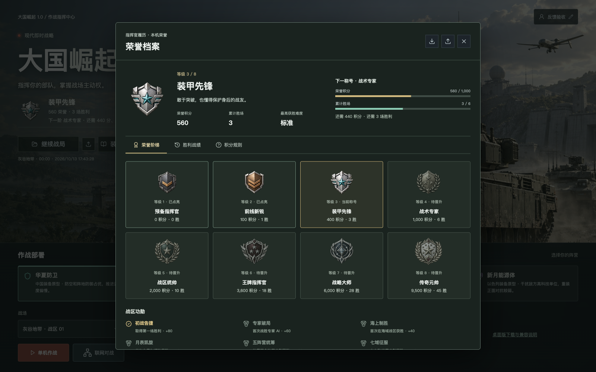 |

| 战略威慑预警 | 战略发射井图鉴 |
| --- | --- |
| 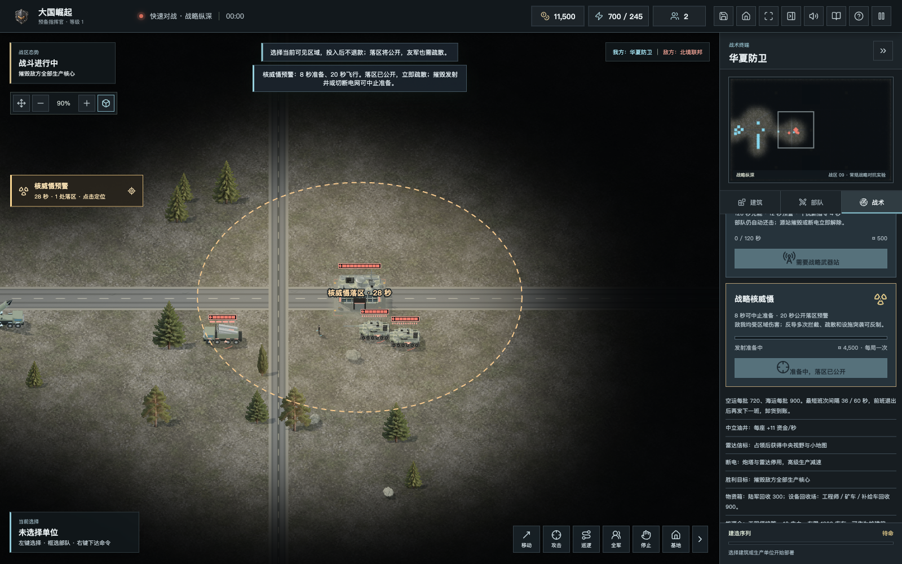 | 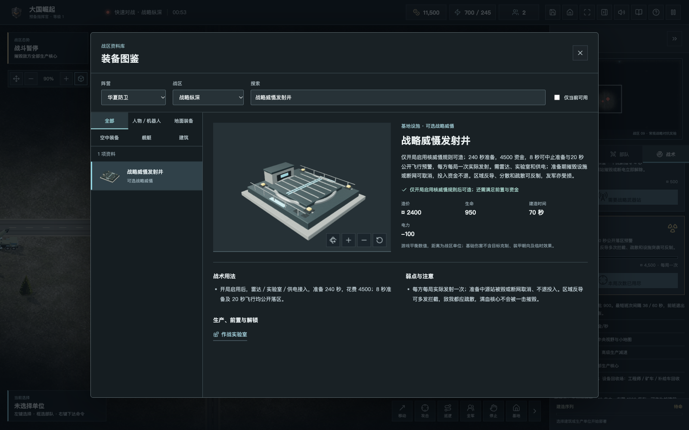 |
| F-22 原型模型 | AH-64 原型模型 |
| 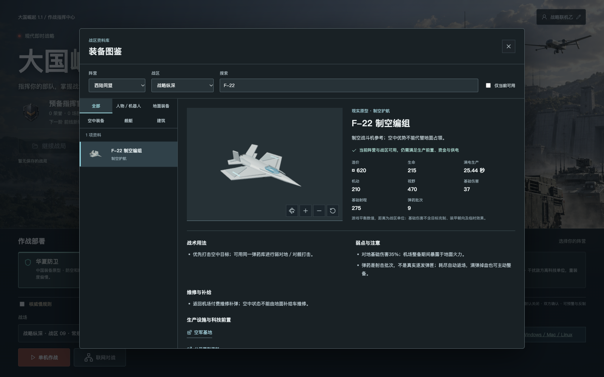 | 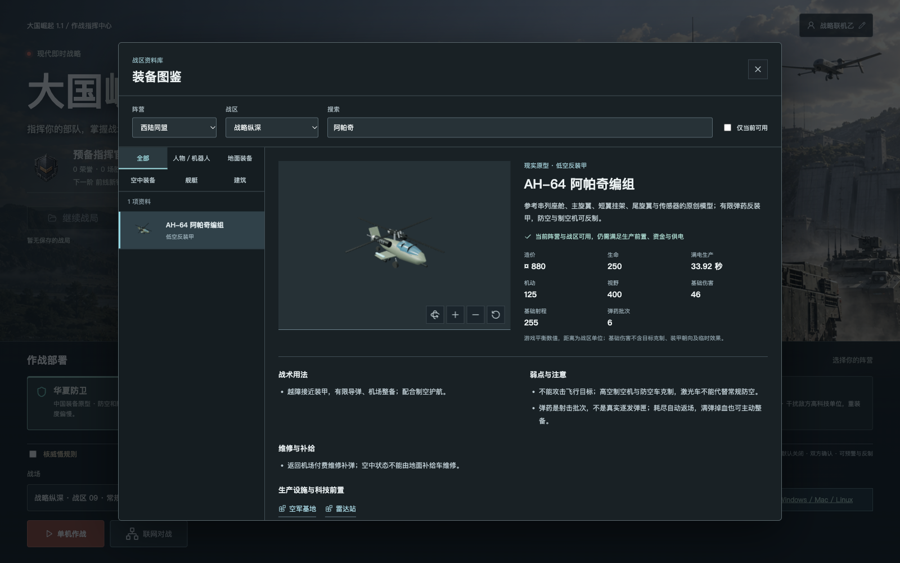 |

更多实机图与素材说明见 [1.1 发行说明](docs/releases/v1.1.0.md) 和 [素材清单](ASSETS.md)。战略截图来自加速、预置单位的受控验收，不是自然完整对局；旧场景截图保留对应内容，首页插画不代表实战模型精度。

## 一局怎么打

1. **建立基地。**选择阵营、地图和胜利规则，部署电力、后勤、兵营、战车工厂、兵工厂、机场或港口。各生产设施有独立队列，建造完成后由玩家选择落点。
2. **建立经济与视野。**常规战区依靠可被拦截的运输机、集装箱船运入物资，并争夺油井、能源仓和补给点；子午环阵保留就地采矿。战争迷雾使侦察和反隐成为进攻前提。
3. **组织联合兵种。**侦察为远程火力提供目标，防空保护炮兵和后勤，电子干扰克制无人机与制导弹药。空军、海军和登陆部队可以跨域协同，但每种强力单位都有射程、弹药、整备或生存方面的限制。
4. **维持作战能力。**士兵和载具会消耗弹药；补给车自动保障可达友军，飞机返回机场、舰艇与潜艇返回港口付费维修和补弹。打掉对手的运输线，往往比只交换战损更有效。
5. **完成目标。**摧毁生产核心、清除敌方全部力量，或占领信标积累控制分数。结算会展示战损与关键数据；单机胜利可获得不增加战力的荣誉积分。

八张双人地图涵盖陆战、桥梁与海峡、远洋、无桥登陆、纵深战区、月表“子午环阵”和新增“战略纵深”；“六域会战”专供六方对抗。子午战区的机器人使用电池与充电设施，离子扰动会影响无保障的空中链路；这些是科幻游戏规则，不是现实装备能力。装备原型与游戏化边界详见 [装备档案](EQUIPMENT.md)。

### 战略威慑怎么反制

仅“战略纵深”可主动启用。建好实验室、雷达和战略威慑发射井，供电正常充能 240 秒后，花费 4500 资金指定当前可见落点。准备 8 秒、飞行 20 秒，全程公开落区倒计时，每方每局最多实际发射一次。准备中摧毁发射井或破坏保障会中止，不退资金；已起飞的弹体不会随发射井消失。

反导车需要雷达、供电、弹药和末段覆盖，四次命中才能拦截一枚；普通防空、激光和电子干扰不能代替反导。疏散、分散部署、打断准备也是反制。打击包含友伤和距离衰减，满血指挥中心单次最多损失 45% 生命，不清图、不永久污染。以上全部为虚构游戏规则。

### 主要操作

| 操作 | 按键或鼠标 |
| --- | --- |
| 选择、框选、下令 | 左键点击或拖选；选中后右键移动、攻击、占领或装载 |
| 攻击移动、停止、全军 | `A`、`S`、空格 |
| 编队 | `Ctrl+1` 至 `Ctrl+9` 保存，`1` 至 `9` 选择 |
| 镜头 | 右键或中键拖拽、方向键、小地图、滚轮；`M` 切换左键拖拽地图 |
| 全屏、侧栏、暂停 | `F`、`B`、`Esc` |
| 返场整备、卸载或起飞 | 选中适用单位后按 `R`、`U`；具体条件可在图鉴查看 |

选中建筑可查看生命、电力、生产进度和用途；顶部提供存档、受袭提示、图鉴及音乐、语音、音效控制。内置离线中文男声和女声可选。

## 开始试玩与开发

**直接试玩：**打开[在线入口](https://43.135.186.21:8443/)，或从 [Release](https://github.com/chencheng666/great-powers-rts/releases/tag/v1.1.0) 下载并解压离线 ZIP，打开 `PLAY.html`。单机存档和荣誉保存在当前浏览器，换电脑或清理浏览器数据前，请在游戏内分别导出备份。新旧联机协议不兼容，更新后请所有玩家刷新页面或升级客户端。

**从源码运行：**需要 Node.js 22.16+、支持 WebGL 2 的现代桌面浏览器。运行游戏不需要安装 Blender；只有重新制作模型时才需要它。

```bash
git clone https://github.com/chencheng666/great-powers-rts.git
cd great-powers-rts
npm ci
npm run dev
```

开发页面默认由 Vite 提供。若要在本机或局域网联机，使用完整源码启动对战服务；单个 `PLAY.html` 文件不能承担服务器职责：

```bash
npm run build
npm run server:lan
```

局域网其他玩家打开启动日志显示的主机地址。部署公网服务、HTTPS/WSS、六方候选战区和数据备份细节见 [联网对战与部署说明](docs/联网对战与部署说明.md)。桌面包基于 Tauri 2；macOS 未 Apple 公证、Windows 未代码签名，麒麟/UOS 仍需按具体架构与硬件实机验证，详见 [桌面兼容说明](docs/桌面版构建与兼容性.md)。

## 技术架构

游戏采用 **原生 JavaScript ES Modules + Vite + Three.js**。规则层与渲染层分开：单机在浏览器运行同一套 `Game` 规则；联机由 Node.js 服务器接收指令、推进战局，并按各席位的视野发送快照，客户端负责输入、插值与表现，而不是自行决定命中或胜负。

| 层次 | 主要实现 |
| --- | --- |
| 数据与模拟 | `src/data.js` 定义地图、阵营、单位和建筑；`src/game.js` 负责战局；后勤、电子战、弹药、月表规则和 AI 分在 `src/logistics-economy.js`、`src/modern-combat.js`、`src/lunar-robots.js`、`src/tactical-ai.js` 等模块 |
| 表现与交互 | `src/render.js`、`src/visual-assets.js` 和模型/动画模块负责 Three.js 场景；`src/main.js` 与 CSS 负责指挥界面；寻路使用 PathFinding.js，图标使用 Lucide |
| 联机服务 | `server/index.mjs` 使用 HTTP + WebSocket (`ws`) 管理游客会话、房间、断线和服务器计时；`server/commands.mjs` 校验并执行指令，`server/battle-view.mjs` 按迷雾生成席位视图；双人与六方协议、Cookie 和数据目录隔离 |
| 素材与交付 | Blender 脚本生成可编辑模型，仓库提供 GLB 与 `.blend`；Web Audio 与内置语音负责声音；`scripts/package-offline.mjs` 生成离线包，Tauri 2 提供桌面封装 |
| 验证 | `npm test` 使用 Node.js 内置测试框架；`npm run build` 验证网页构建。发行前另做浏览器实机、离线文件、双客户端联机和密集战斗验收 |

```bash
npm test
npm run build
npm run package:offline
```

本轮 347 项自动测试通过，覆盖战略装备、核规则、真实双 WebSocket 会话、情报隔离、存档、反制与下载清单；另有 5 项发布数据库回归检查。桌面验收覆盖标准／高画质和 1600×1000、1280×800，无 WebGL 错误。公网与下载验收结果见 [1.1 发行记录](docs/releases/v1.1.0.md)。高丢包、高并发、240 单位密集交战性能及所有国产硬件尚未全面验证，自动测试也不等于竞技平衡。

## 下一步：走向 2.0

1.1 已补战略地图、现代装备专属简化模型和可选核威慑闭环。后续继续精修，而不是把原型写成完整 2.0。当前状态、反制与未完成事项以 [2.0开发清单](ROADMAP.md) 和 [装备档案](EQUIPMENT.md) 为准。

- **画面与性能一起升级：**优先打磨陆战、海战、子午三类标杆场景，统一模型比例、材质、地面接触、动画和交火反馈，同时建立 120/240 单位的性能预算。
- **提升指挥手感：**继续改善群体寻路、编队间距、射界、撤退整备与大部队操作，减少车辆拥堵和误操作。
- **丰富单机目标：**加入有明确任务和反制路线的战役/挑战关卡，以及可回看的关键战斗事件；用真实玩家对局数据校准阵营、地图和 AI。
- **使六方联机成熟：**完善持续对局、重连、观战和服务容量后，再评估组队、匹配与排行榜；微信身份接入以平台条件和隐私设计完成为前提。
- **继续共建：**更多舰艇、空天装备和月球基地仍属设计方向；战略装备和核规则先在实验地图验证，不等于完整 2.0。玩家提出的“明日”命名保留为社区提案，尚未决定更换项目名称。

以上为后续计划。我们优先把既有战斗做得可信、清晰、流畅，再扩充装备数量。

## 参与共建

欢迎在 [Issues](https://github.com/chencheng666/great-powers-rts/issues) 提交玩法建议、平衡意见和缺陷，也欢迎提交 Pull Request。报告问题时请附地图、阵营、游戏模式、复现步骤、系统/浏览器版本与截图；存档分享前请移除个人信息。感谢 CAI 和持续试玩、提供有效建议的玩家。

代码许可见 [LICENSE](LICENSE)，第三方依赖与素材许可见 [THIRD-PARTY-NOTICES.txt](THIRD-PARTY-NOTICES.txt) 和 [ASSETS.md](ASSETS.md)。请勿把未授权的原游戏素材、音乐、配音或其他作品模型直接加入仓库。
