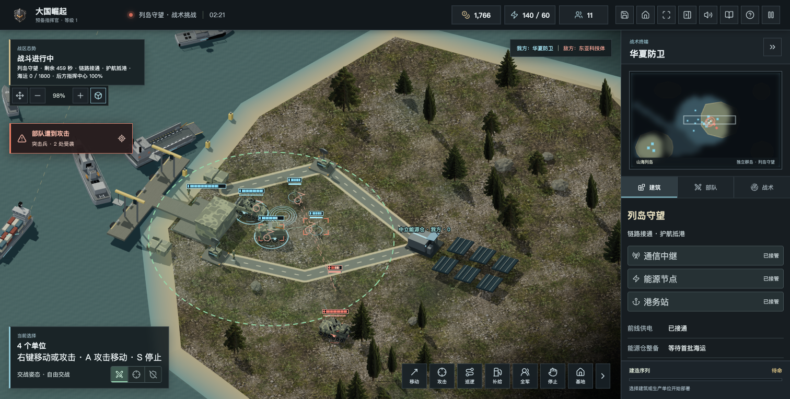

# 列岛守望：开发与验收

日期：2026-10-22。状态：本地先行内容；统一发行验收中，不是正式 2.0 上线公告。

## 已实现

- 新增独立「山海列岛」：4480 × 3200，五座不相连的多边形岛屿，无陆桥。保留旧海峡图和旧关卡。
- 海陆碰撞、舰体净距、地表高度、岸带、小地图和合法登陆点共用地图几何；地面单位不能走海，舰船不能穿岛。船只使用现有 PathFinding.js A 星库绕岛，对已知停驻友舰避让，不从迷雾获取敌方位置。
- 「列岛守望」首关：600 秒、1800 整备资金；满载登陆舰为 12 格／6 个载员，另有驱逐舰、护卫舰及巡逻舰护航。
- 西侧沙滩停驻后按 U 逐个卸载，每 0.75 秒一个。再次按 U 可取消；移动会取消后续卸载；合法空间不足时保留乘员并显示原因，不重叠生成。
- 通信、能源、港务三个节点各需工程师持续作业 6 秒。敌军进入 160 范围或工程师刚受击会中断；工程师不会因接管消失，可继续接管其他节点。
- 敌方陆战部队独占节点 12 秒使其失守；我方守军在场时只争夺，不直接跳归属。可夺回，不重置已交付物资。
- 三节点与有效供电接通后才派海运。两条可选航道、每批 900、最多 5 批；断链暂停派船及卸货，不消除船货；空载返航不重复结算。本关没有应急空运。
- 完成两批海运后由陆战守军连续驻守 20 秒通关；争夺、失守或守军离开重新计时。保住指挥中心和前线港；明确提示超时、港口损失、无法补发和工程师耗尽等失败原因。
- 首批抵港后，能源仓开放有费用的陆军维修补弹和补给车库存补充；失去链路暂停前线整备，陆军不再试图跨海走回后方工厂。
- 新任务使用共享回执、航道与港口队列。货运靠泊点、军舰维修位置和登陆区错开，修复实测中护航舰堵住货运交付的问题。
- 三维岸带、较暗的真实细颗粒地表、自然海面、太阳能阵列、防滑金属与沙滩标柱；码头按实际向海方向旋转及清理遮挡。
- 接管、卸载、货运、驻守、波次和成绩可存取。新图暂不开放遭遇战和联网，菜单与服务端均限制，避免把不对称单机关卡当成公平竞技图。

## 验证

2026-10-22：468 项自动测试通过，生产构建通过。日志位于本机忽略目录 `releases/islandwatch-tests.txt`，详细证明随本目录验收记录继续补齐。

重点测试包含：多边形海岸与舰体净距、绕岛压缩航段、非法岸线、卸载取消与中途读档、争夺和重新接管、断电及恢复、有效回执去重、有限补发、首批海运开放付费整备、旧挑战存档、两条航线、三组正常指令通关，其中一组在首批抵港后读档续战。未通过修改资金、生命或任务计数来实现通关。

浏览器已从任务菜单正常开局，原生鼠标选择登陆舰并右键驶向沙滩、按 U 分批卸载，后续通过正常指令接管三节点，完成两批海运与 20 秒驻守，03:53.9 两星通关并保存成绩。无脚本报错，WebGL 错误码为 0。

1.3 系列离线 ZIP 为 56.33 MiB，已通过压缩完整性检查，并直接以 file 协议打开、启动列岛守望，未请求外部网络资源。1280×720 和 1920×1080 桌面布局无横向溢出。最终公网验收发现慢网首次打开挑战时缩略图依赖未就绪，已在 1.3.1 中改为文字先显示、模型异步加载，加载失败可重试；浏览器阻断模型请求时六关可见且无脚本异常，解除阻断后六个缩略图恢复。精确文件与统一发行状态以 [1.3.1 发布核验](../releases/v1.3.1-verification.json) 为准；本目录早期 verification.json 保留开发时的历史检查点，不作为最终发布结论。

## 实机图

图片为本地浏览器运行的实际关卡，不是概念图；首张较早的岸带草稿保留作开发对照，不作为最终效果。

## 仍未完成

- 本关重点是一次主岛登陆与后勤闭环，另外三座侧翼岛尚无独立机场／资源争夺任务；不是完整多岛战役。
- 深蓝生命线仍使用旧海峡原型，不冒充独立远海群岛完成。远东及其余战役未完成。
- 社区三维模型优先复用已经列入资产筛选流程，但候选模型尚未替换当前单位；不以代码许可证代替网格授权。
- 本地图的双人、六方、合作、真实弱网及国产硬件性能未验收，暂不开启。现有旧地图的联机回归不等于新地图已支持联机。
- 腾讯云终端已接通上海实例，发布前确认两服务为 1.2.1、无房间与对局，个人站路径保留。统一部署仍按独立发布记录核验，禁止覆盖账号数据或绕过身份验证。
