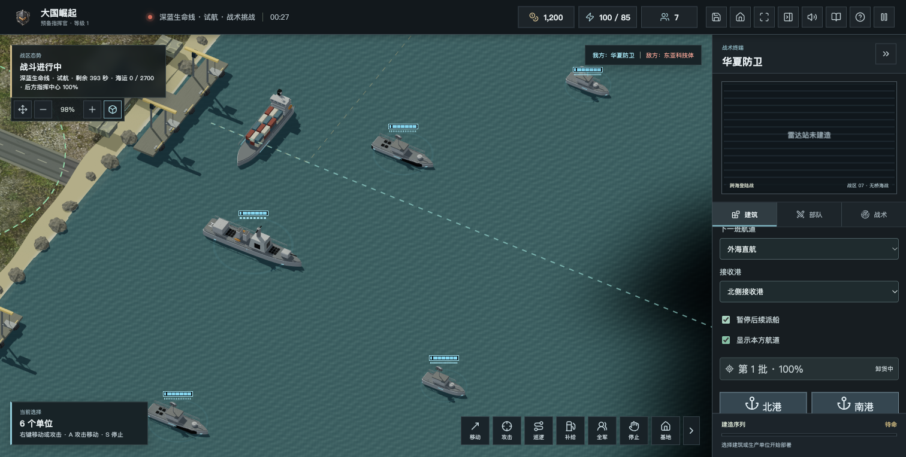
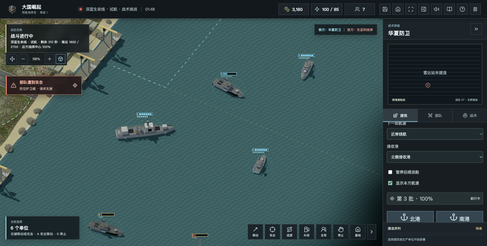
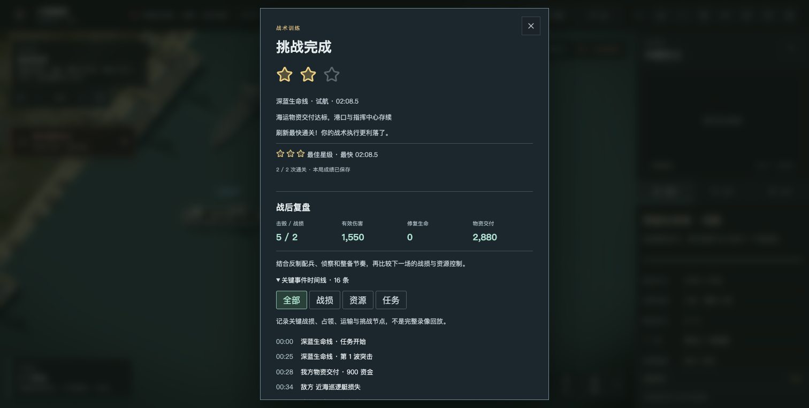
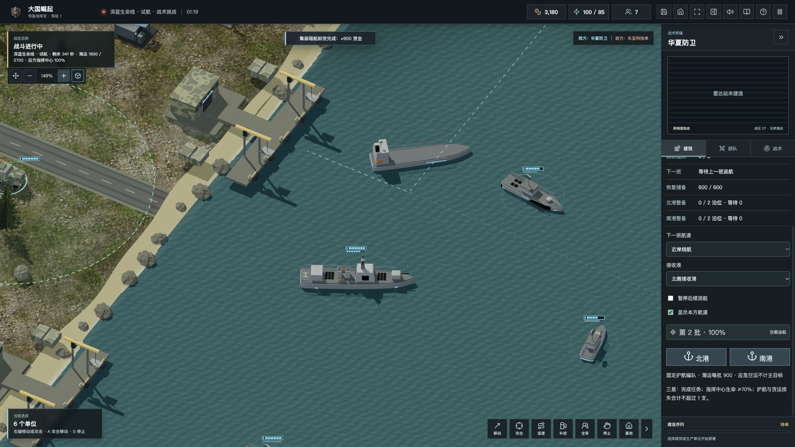
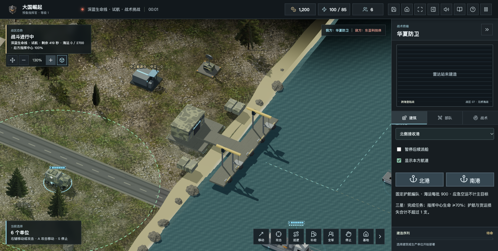

# 2.0 山海防线：深蓝首轮开发

日期：2026-10-22。状态：本地开发候选，未推送、未打包发行、未改生产服务器。游戏发行版本号仍为1.2.1，不提前标正式2.0。

## 需求来源与统一方向

已读取任务 [名字的意义](codex://threads/01a1616c-74ef-7e51-9c94-b67def768417) 的最新两轮确认，与工作区两份规划核对。九大战区全部保留，采用原创架空场景，不引入现实攻击路线或领土索取清单。

主题为「守护山海，走向深蓝」。优先打通运输、护航、港口整备、登陆接管，再扩展战区与任务，不按地图名称堆数量。

## 九战区进度

| 战区 | 状态 | 当前实际支持 | 下一步 |
| --- | --- | --- | --- |
| 深蓝生命线 | 开发中，试航闭环本地验收 | 单机独立挑战，复用既有无桥海图；不是独立群岛新地图 | 独立远海地形、岛礁与航线碰撞、港口调度深化、长局节奏与AI截击 |
| 列岛守望 | 新战区未开始 | 既有抢滩接力仅为可复用基础，不等于完成本战区 | 真实多岛岸线、工程接管、供电及货运接驳、失守夺回 |
| 远东·寒境守望 | 未开始 | 无新战区开放 | 寒区山地、滨海港区、双路线运输与节点修复 |
| 海峡风云 | 未开始 | 无新战区开放 | 分阶段立足、接通运输与守住前哨 |
| 山口防线 | 未开始 | 无新战区开放 | 有限编队、预警压力、撤退整备与接防 |
| 归航行动 | 未开始 | 无新战区开放 | 保护、分批撤离、去重结算；合作另验 |
| 钢铁走廊 | 未开始 | 无新战区开放 | 接管、修复、供电和运输决定有限产出 |
| 战略警戒 | 新任务未开始 | 既有战略地图及可选威慑基础仍保留 | 预警与分散设施保护任务，常规可通关 |
| 明日·月海基地 | 新任务未开始 | 既有子午、机器人与采矿基础仍保留 | 储能、中继、通信断线与恢复循环 |

新航运管理与有限港口泊位本轮只进入单机试航，不直接改变线上双人、六方或旧四关规则。未验证的新规则不出现在联网房间配置中。

## 已实现的试航闭环

入口：主界面 → 战术挑战 → 深蓝生命线·试航。

固定护航编队、1200初始整备资金、420秒上限；每批海运900，累计2700有效交付且至少一个接收港和指挥中心存续才获胜。无需清场，首船沉没不直接失败。通常两到数分钟可完成，尚未达到规划中的15—25分钟正式战役目标。

- 五批海运上限由本方共享，北南两港不会各自复制配额。
- 近岸绕航与外海直航可切换，选择只影响下一班；本轮为固定航点，不是任意海图路径规划。
- 可暂停后续派船、改选接收港、定位货船和港口、显示或隐藏本方虚线航路。
- 港毁后改派友港，不传送船体，正在卸货的进度重新计算；两港全毁或剩余批次不足以达标时明确失败。
- 货船实际抵港停稳，有电且脱战后才卸货；每批回执唯一，重复调用、存读档不重复领款。
- 海运与空运分开计目标。应急空运最多两班，每班180；另有最多600的有限恢复储备，在资金低于350时按每秒2补充，不是无限免费收入。
- 每港两个维修泊位，额外返港舰艇在外海等待。取消订单或改港释放位置，资金不足、断电不扣弹、不免费维修；潜艇使用原有浮航表现。
- 星级与现有挑战档案、重试和复盘衔接；普通荣誉不受影响。新增港口维修、舰艇补弹支出指标，旧存档无该字段按零显示，不补造历史支出。

## 画面和工程

货箱增加共享涂层、凹凸与粗糙度，原有箱壁与锁杆随货物归组，结算后空载返航会清空可见甲板货物。港口增加共享混凝土、金属与橡胶表面以及系泊、防撞细节，仍按材质合批；没有重建全部舰艇，也未宣称达到写实扫描精度。

实机近景发现长码头超出原有圆形清理范围，补齐按实际码头轮廓清理岸边装饰；东西岸镜像以及设施易主后都按位置判定方向，不用当前归属错误翻转。

港口模型测试限制不超过8个网格、6000三角形，检查UV和共享纹理；这是结构预算，不是120／240单位实测帧率。大军团性能、标准／高画质和目标国产硬件仍待独立验收。

修复开发预览误扫描历史离线HTML导致内存耗尽的问题：依赖扫描仅从当前 `index.html` 进入，不提高堆内存掩盖扫描范围问题。

最终回归发现旧攻击机测试偶发混入开局坦克的随机开火，造成“导弹不应瞬间命中”的断言被其他武器伤害干扰。测试单独隔离初始部队，不放宽断言，也不修改正式火力与延迟规则。

## 验收与截图

- 全量459项测试通过，生产构建通过；新增13项测试覆盖派船控制、抵港结算、重复批号、补发上限、港毁改派、断电受袭、零资金恢复、有限泊位、取消释放、存读档、正常完整模拟、材质预算、码头穿模。
- 浏览器从正常菜单开始，操作航道与派船开关并完成试航；不借调试接口修改资金、交付或任务进度。
- 首次实机通关用时约02:08.5，三星；发现并修复胜利瞬间HUD进度未同步刷新问题。
- 修复后再次从菜单完整通关，第三波抵达后两星完成，HUD正确显示2700/2700；1280×720和1920×1080桌面检查无横向溢出。
- 画布像素检查：2376×1412，抽样51745个非暗像素、5177种RGB组合；证明画布非空，不用于承诺帧率。
- 截图为本轮实际引擎测试场景，不是宣传概念图。

## 后续范围

先完成真实多岛海陆判定与舰艇航路，再将试航机制用于独立深蓝地图和列岛任务。不能仅加几块视觉岛屿而船仍能穿岛，也不把几张独立关卡称为连续战役。

仍缺：完整进出港队列和登陆服务分区、可重建接管中转港、观测约束的截击AI、复杂海域重连／六席验证、独立大军团性能报告及九战区其余任务。已有其他规则与本轮限定规则需要逐项迁移验收。

后续发行仍沿用现有域名及 `/play/`、`/candidate/`、`/downloads/`、`/resume/` 路径；本轮不自动推送GitHub、更新下载或部署。
