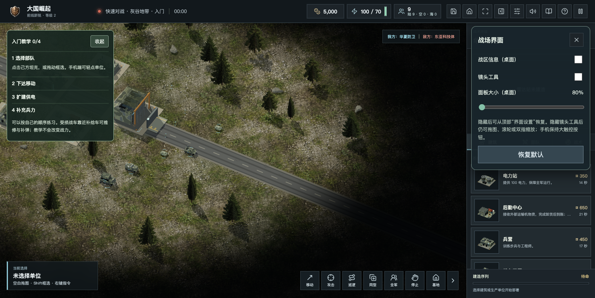
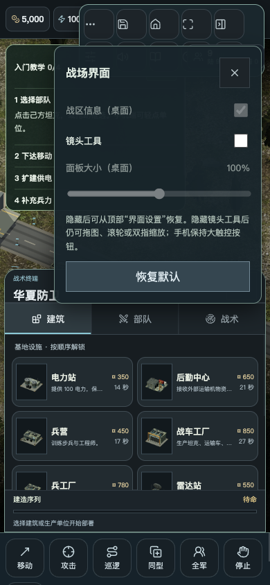

# 公众号反馈与客户端诊断修复 · 2026年11月2日

## 核查范围与边界

核查8篇《大国崛起》相关文章的当前近期留言页，以及最近3个私信会话。其中一条近期私信是《九级》的玩法问题，本轮不修改另一游戏。旧文章未把所有多页历史回复逐条重读，已有修复不重复声明为新增。

后台按2026年10月26日至11月2日查询，读取36条错误记录，未出现100条截断；所选范围暂无游戏内意见反馈。重点包括背景视频资源失败、移动端无详细位置的脚本错误、少量画面中断与网络断开。旧日志缺失错误原文和堆栈，不据此推测全部根因，更不能宣称36条都已经根治。原始后台导出、私信原文、截图及联系方式仅留在忽略的本地验收目录，不公开提交。

## 本轮已修复

- 粉丝反映左上角战区信息与镜头工具遮挡视野：顶部新增“界面设置”，分别隐藏／恢复两类面板；桌面大小可设80%—120%，独立本机偏好，不写入战局、不改变战力和镜头缩放。手机保持触控尺寸，通过“更多操作”进入设置，避免面板缩小导致误触。顶部入口始终可以恢复隐藏的工具；面板与教学位置自动避让。
- 树影方向与建筑不协调：可视树冠贴片不再直接投影，改用与太阳朝向一致、直立接地的实例化轮廓投影。切换镜头时投影变换不变，迷雾未知时轮廓缩为零；四个树种批次，各增加一个投影批次，保留现有模型与纹理。
- 背景视频正常中止被误当故障：开局或切换页面导致的旧play取消不再改写新播放状态；真正失败时保留海报和手动重试，避免不可恢复地禁用背景按钮。
- 错误记录缺乏定位：渲染中断与未处理Promise异常新增安全类型、故障阶段、同源资源文件名及代码位置；仅上传白名单故障标识，不上传错误消息原文、完整堆栈、网址参数或玩家输入。正常视频取消不再记作资源失败；真实媒体失败保留媒体错误码。补齐素材准备阶段已捕获错误的上报，按故障指纹去重，避免视频错误遮住关键模型故障；每分钟最多8类，客户端缓存有界。服务端现有160字符限长、管理员鉴权和12个月保存机制保持有效。

## 仍需复测

- “卡在初始页面”没有设备、浏览器版本与复现存档；新版桌面和窄屏开局成功，并模拟模型请求失败后恢复网络重试成功。仍需原反馈环境补充信息，不宣称已定位该玩家的根因。
- 旧日志仅有line:0、空详情或笼统网络中断的记录不能回补，需观察新构建的脱敏定位及复现结果。既有记录保留，不通过清空日志来冒充修复。
- UI整体美术风格、原生手机安装包、大型历史战役等为建议，不在本轮承诺完成。

## 验收

- 全量613项自动测试通过；补充客户端监听隐私验证后，28项针对性测试通过。涵盖正常视频取消、失败重试、诊断脱敏、界面偏好损坏、树影接地与相机无关、鉴权、反馈限流、数据保留及资源队列重试。
- 生产构建通过；真实浏览器验证隐藏、80%缩放、恢复、390px移动设置无溢出、手机保持标准控件；树木阴影实例在两种镜头下矩阵一致，WebGL错误0、未捕获异常0。
- 人为阻断关键GLB请求，页面显示素材失败且按钮可重试；解除阻断后同页重新开局成功。同时核对到脱敏日志“Error stage:startup code:network battle-library.glb”。此为加载失败恢复验收，不替代原玩家设备的复现。
- 新免安装ZIP压缩校验通过，直接打开PLAY.html并在断网状态开局、切换界面设置，无脚本错误和裂图。

## 版本范围

网页构建 `20261102-feedback-diagnostics-r2`，版本号仍为2.0.2。新ZIP：`Great-Powers-RTS-v2.0.2-20261102-feedback-r2.zip`，55,412,479字节，SHA256 `d4b773bba6d221531fd95130d5b6734a1a9ac75564606d1d99699ab98d80d2f5`。

本轮ZIP包含同日上午陆空比例修复；历史ZIP保留。桌面安装包与应用商店包未在本轮重建，不能将源码／网页更新当作商店审核或对应硬件验收完成。

后续静态发布、实际公网验收与粉丝回复结果单独补记。
