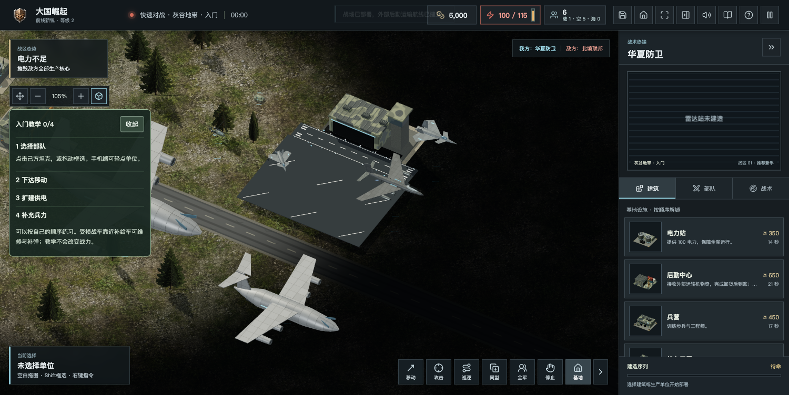
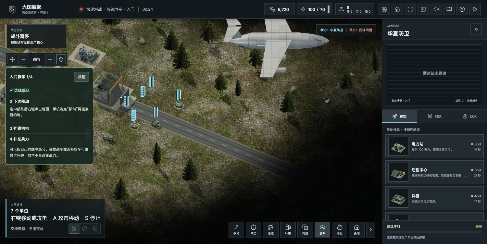

# 11月2日陆空比例与补给飞机修复

本轮按粉丝《大国崛起bug汇总(2).pptx》2026年11月版本的合理建议调整表现。第8页只作为陆地游戏美术比例参考，不宣称严格按实物米制还原，也不套用到舰载机。

## 已完成

- 陆地坦克、武装直升机、战斗机、轰炸机、运输机长度基准为 28、33.6、56、84、224，对应游戏比例 0.5 : 0.6 : 1 : 1.5 : 4。陆地其他车辆和人员同步协调尺度；逻辑碰撞、成本、生命与火力不改。
- 起飞时连续放大到地面长度的1.5倍，空中保留机种相对比例；舰载机维持原独立甲板尺寸。
- 资源补给飞机映射到同阵营运输机模板并采用相同尺度。西陆同盟继续使用双旋翼运输机，月面继续使用独立科幻外观。
- 去掉现代陆地车辆附加五角星，保留阵营颜色、地面身份轮廓及选择圈。直升机尾桨改黑色低反光材质，保留独立旋转轴。
- 修复无专用起落架的飞机被机场铺装遮住、滑行连接处下沉、离开起飞队列后再次下落起飞的问题。补齐机坪与跑道之间铺装。
- 航母区分实体舰载机总数、甲板停放数和出动数，抽象打击编组另行标注。现有实体容量仍为3架；二三十架同舰停放需后续联动甲板、补给、联机和渲染预算设计，本轮没有虚增数量。
- 修复按需加载后的单HTML离线打包，图标内联，生成独立日期ZIP；官网、下载页标注本轮更新，历史包保留。桌面安装包与商店版未在本轮重建。

## 本地验收

- 全量607项自动测试通过；包含真实模型包围盒比例、五阵营补给机映射、尾桨材质、机场接地、航母数量与损失回归。
- 补齐连接铺装后，17项相关回归再通过；生产构建通过。
- Ego Lite真实页面：缩小坦克可正常点击选中；无五角星附加几何；停机飞机完整位于铺装上方；起飞滑行至巡航连续放大，没有重新从地面起飞；未捕获脚本错误。
- 新ZIP通过压缩校验；直接打开解压后的file:// PLAY.html，在该页断网状态成功开局、选择7个部队，无脚本错误和裂图。此项为macOS Chromium离线验收，不替代Windows/统信真机验收。

## 发布范围

前端构建：20261102-land-air-scale；游戏版本仍为2.0.2。
离线包：Great-Powers-RTS-v2.0.2-20261102.zip，55,409,651字节。
SHA256：2f7011e48d7a4a5c01837cc74b69885f9889e9c16a76e4ea44db5e340e855bc4。

采用静态资源增量发布，不重启对战服务，不修改玩家账号、战绩、统计库或个人站。服务端健康接口构建号仍保持上次后端构建；实际前端入口与资源需单独核验。线上验收结果另行补记。

## 保留后续评估

港口／机场重做、全部生产改成外部增援、舰艇声呐和掉头、弹道车朝向等属于本份PPT的其他建议。本轮聚焦陆空模型与起降表现，未将整套玩法替换。
