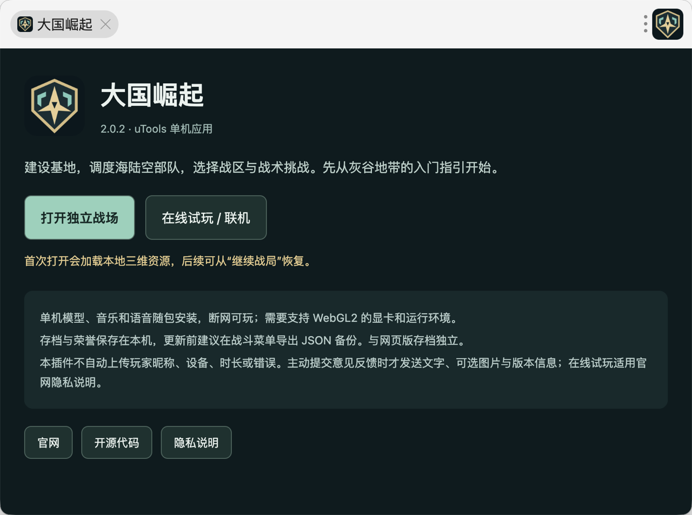
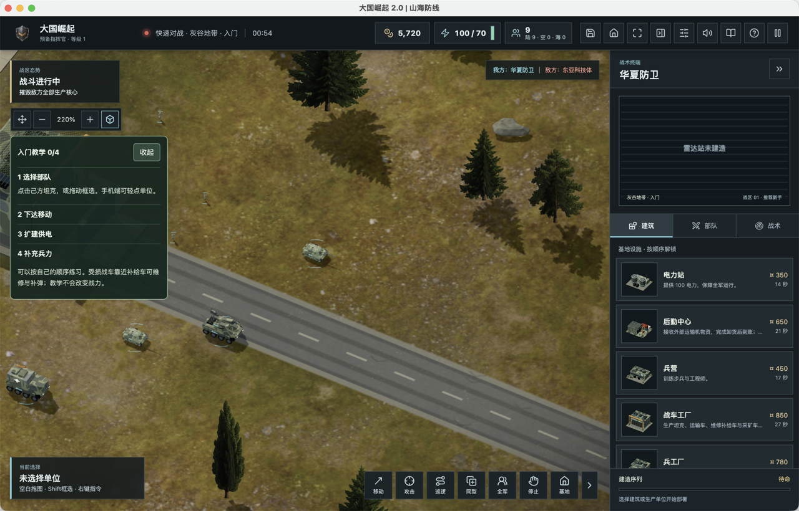

# uTools 插件应用与发行验收

## 应用和包

- 应用 ID：`zb3fvcnl`；开发者：陈成。开发者工具内的应用名称已由用户调整为“红警2030之大国崛起”，游戏内名称保留“大国崛起”。
- 版本 2.0.2，正式包由 uTools 开发者工具“构建离线安装包”生成，格式 `.upxs`，不是将 ZIP 改扩展名。
- 文件：`Great-Powers-RTS-v2.0.2-utools.upxs`；53,610,604 字节；SHA256 `69fb6951b01de3c0c8a27e8e746656c903dab3f3f9b1bf00241fca3460dc0436`。
- 开源目录为 `packaging/utools/`，`npm run package:utools` 生成可导入的发行目录。正式安装包不含服务器、后台、玩家数据与凭据，包含游戏与素材许可证。

## 行为

- uTools 入口创建独立战场窗口，资源、音乐和语音随包安装，离线单机不依赖本地服务器。
- 游戏窗口关闭 Node.js 集成、启用上下文隔离与浏览器安全校验，不暴露任意本地文件读取桥接。
- 网页与 Tauri 现有路径保持原行为；仅带本地发行标记的 uTools 包禁用自动玩家统计和错误上报。主动反馈仍需玩家点击提交。
- 外部入口限制为官网、在线试玩和项目 GitHub；本地窗口缺少宿主 API 时说明回到入口操作，不随意导航到远端特权页面。
- 存档与设置留在本机；升级前可导出 JSON 备份。官网联网对战由系统浏览器打开，与离线进度分开。
- 首次启动不等待可能迟迟不到的页面加载回调；先显示深色窗口，同一入口实例复用已打开的战场。

## 验收证据

- 全量 620 项测试通过；最后调整窗口启动方式后，5 项定向测试通过。含主机识别、固定链接、自动统计关闭、窗口复用与失败重试。
- 正常网页构建、uTools 发行构建和发行目录十二个文件摘要校验通过。
- 直接打开内置游戏文件，菜单准备约 895 毫秒（本机一次观测），WebGL2 可用，进入战场后未观察到自动公网请求。此计时不等于所有设备首屏保证。
- macOS + uTools 7.8 已实际安装开发版，打开独立窗口、进入灰谷单机、暂停、手动保存、导出 JSON 和读档成功。恢复到 `00:54`、5,720 资金、9 个作战单位。
- Windows、Linux 与其他显卡尚未在 uTools 宿主内完成真机验证，不宣称所有系统兼容已通过。

## 平台与发布边界

版本说明和应用介绍已填入 2.0.2 市场发布表单并回读。当前尚未取得“提交成功”“审核中”或“已上架”回执，不能把注册、开发版安装或生成 UPXS 当作市场通过。截图上传与最终提交待继续。

原生控制工具无法识别 uTools，用户已明确允许改用 AppleScript/System Events。开发者协议取得用户本次明确同意。原生窗口后续受到系统保护遮罩和窗口切换影响，已请求用户手动恢复发布界面；不通过修改系统安全设置继续操作。

源码 `36d7a10a57e23aa53cd5e317de1e70c6749fafa1` 已推送 GitHub main；候选发行 [utools-v2.0.2](https://github.com/chencheng666/great-powers-rts/releases/tag/utools-v2.0.2) 已公开发布，平台 API 回读 `isDraft=false`、`isPrerelease=true`，安装包与校验附件均为 uploaded，远端包大小及 SHA256 与本地一致。此发行不是 uTools 应用市场上架。

官网增量包 `utools-20261102-r1.tar.gz` 已准备，SHA256 `76cbe0cdc25b733c0b8c868960d18e963c77ed521b4c5290632ee38a33be8081`。本地真实 HTTP 验证新隐私页面 200、UPXS 下载 200、完整包哈希一致，且一次下载只增加一次本站计数。

原 Ego Lite 工作区 28 已关闭，按浏览器技能暂停服务器同步并请求用户确认重开，尚未切换官网、未重启对战进程、未修改玩家数据库。
