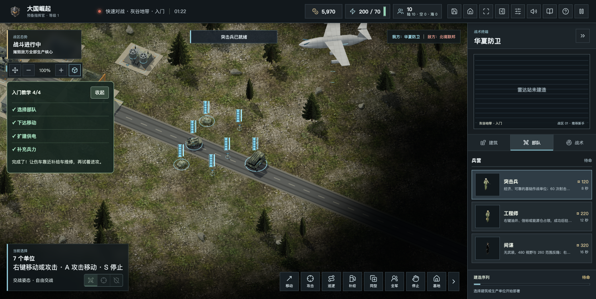
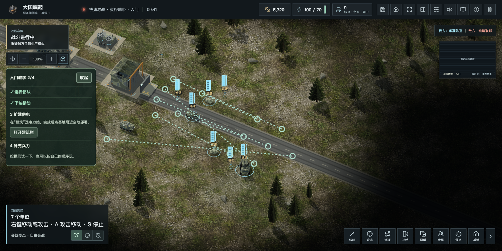

# 粉丝反馈：补给巡逻与直达教学

2026年11月3日。网页构建`20261103-patrol-guide-r1`，游戏版本保持2.0.2。

## 核查与处理

核查7篇《大国崛起》相关文章当前可见的近期留言，以及4个私信会话；没有逐页重读全部历史留言和折叠回复。有些近期交流涉及《九级》，不把另一项目反馈列为本游戏缺陷。原始私信、联系方式和后台页面不进仓库。CAI对长期方向的讨论按作者提供材料概括，不公开私聊截图。

- 一条近期私信提出巡逻不好用。复核后确认补给车有巡逻指令却未执行路线，现接入原有往返逻辑：沿途有限保障，手动路线优先于自动追车；缺货仍按原规则回厂付费补货后恢复原路线；无工厂且空库存也能巡逻撤离。
- 巡逻按钮与P键统一提示：先选部队、指定终点、停止结束；未选部队不进入无效定位。
- 灰谷四步教学文字简化，增加定位坦克、准备移动、打开建筑和部队栏入口。只引导视图与操作入口，不自动造兵建造、不改战力、不计奖励。
- 界面风格、手机安装包、账户同步、匹配、科技和连续战役等建议另记规划，不冒充本轮已实现。

## 验证

625项自动测试通过，含3项新增补给巡逻回归；已有补给费用、阻挡、弹药、存档、隐私、反馈限流与保存机制回归通过。网页与免安装ZIP构建通过；ZIP压缩完整性检查通过。真实页面验收：桌面按选择、移动、建电力站、生产实际完成4/4；直达按钮分别定位镜头、进入移动和聚焦建筑／部队卡片。390px页面无横向溢出，教学默认收起，可展开定位。公网实际开局、巡逻路线与提示正常，未捕获脚本异常。离线文件在阻断全部HTTP/HTTPS请求时仍能开局、进入教学和移动模式；联网统计仍保持既有披露，不把离线可玩解释为普通ZIP不尝试上报。验收后停止临时战局，逐项恢复原本机游戏存储。

新ZIP：`Great-Powers-RTS-v2.0.2-20261103-patrol.zip`，55,413,967字节，SHA256 `eab1073f7f05a2d6680d00aa69d0b7307202692432ec25a2a72c5f0f8a50224a`。包含当日三层比例与人物辨识改动。桌面安装包与商店包本轮没有重新构建。

## 长期方向

[5.0征集路线](../plans/v5.0.md)接续原3.0与3.1～3.3原型路线，保留短局、先验证小规模经营与战役，再决定整合扩展。所有后续能力均为候选规划。

## 发布与数据保留

- 已推送GitHub main：源码`bac769f3822cf0cefca6b114cab918c114b4d541`。公开增量发行[web-patrol-20261103](https://github.com/chencheng666/great-powers-rts/releases/tag/web-patrol-20261103)，标记为预发行；ZIP与服务包附件状态uploaded，摘要和本地一致。
- 使用`package-tested-web-release.py feedback-patrol-20261103-r2 --offline`打包，`deploy-strategic-release.py --domestic`发布。服务包56,201,193字节，SHA256 `f2d1ddb41e05a277ee5111be60afac46477ae720bc517c5ed5b5830b1ad3c89e`。241项发布资源摘要校验通过，历史媒体继承后校验。
- 上海发布目录`/opt/great-powers/releases/feedback-patrol-20261103-r2`，备份`/opt/great-powers/backups/feedback-patrol-20261103-r2`。两个服务在房间／对局均为0时短暂停服备份并切换；健康构建均为`20261103-patrol-guide-r1`，双人／六方协议4／5。
- 六个数据库完整性检查均ok，备份与现库逐表计数没有减少，包括两套账号战绩、两套玩家统计及两个九级统计库。不修改个人站、其他服务及原数据目录。
- 官网、试玩、六方页、下载页与清单、uTools隐私、个人站及两个健康接口均200；试玩与六方均引用`/assets/index-CCQYQ5II.js`。公网完整下载本轮ZIP，大小和SHA256与清单、本地一致；原三层比例ZIP及uTools包仍200。无管理员会话的诊断查询返回401。
- 公网首次模型加载检查使用30秒等待上限时超时，素材请求耗时约22～30秒，自动化恢复中止了当次初始化；重新加载同页后正常开局并完成巡逻检查。这不构成加载提速结果，较慢网络首次开局仍需要继续优化。

## 公众号草稿

已保存新稿《谢谢新老朋友：《大国崛起》想和大家一起走向5.0》，草稿ID `100000834`，6张游戏截图与封面。再次从草稿箱打开临时预览，核对标题、CAI讨论、已更新的巡逻段落与征集内容，6张正文图全部加载。仅保存草稿，未发表；没有发送私信、留言回复或进行精选管理。没有公开原始私聊截图与粉丝联系方式。
