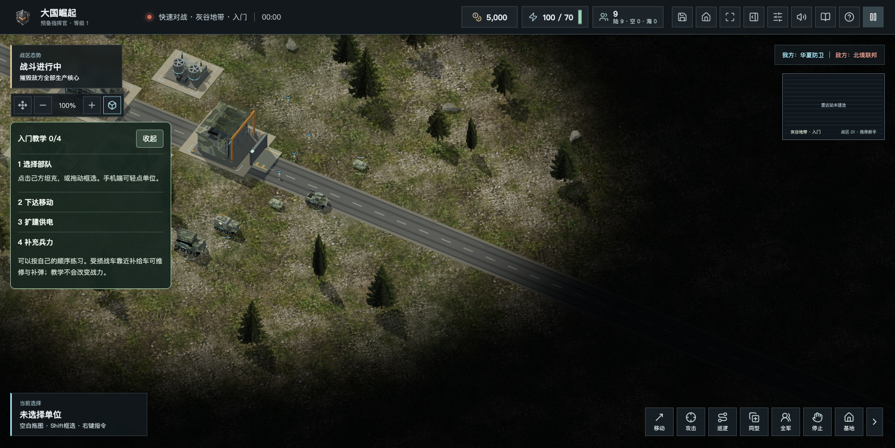

# 三层高度与单位比例调整

本轮采用玩家提供的新 PPT 比例，在100%镜头下协调现代地面、低空与高空单位。游戏展示使用美术尺度，资料中的实物米数用于相对比例参考。

- 人物显示高度约9.68，以1.75米人物与2.4米参考车高的比例校准。参考坦克长度36，人物约为其显示高度的73%。步兵、工程师、侦察员采用同一身高基准。
- 坦克、直升机、战斗机、轰炸机、运输机的停放长度关系为0.5、0.6、1、1.5、2。运输机及补给机空中目标长度由336收至180，战斗机90、轰炸机135；起飞比停放大25%，尺寸连续变化。舰载机保持独立甲板基准。
- 低空无人机26、旋翼42；制空机80、轰炸机100、运输机和补给机112，随地形计算相对高度。双旋翼运输机按低空旋翼处理。
- 人物增大、携行具与头盔提亮，近远景共用轮廓增强。小型队色识别符遵守迷雾、死亡与登载状态。战力、造价和碰撞规则保持原有逻辑。

## 验收

622项自动测试通过。真实页面完成100%开局、三层受控场景与240%人物近景检查；三维场景无异常。敌方步兵进入战争迷雾后模型隐藏，识别符描边数从8降为6。

390px窄屏的页面宽度为390，无横向溢出；实际触摸拖动后存档中的镜头中心发生变化。原离线试玩页的本机游戏存储在验收后恢复。

新离线ZIP为55,413,303字节，SHA256为`a4b550507cd5e74c6075a185f045a647eff17c397255dc647ccf118fe8dd6406`。阻断HTTP/HTTPS请求时，file协议页面仍能进入9单位的单机战场并暂停。此项证明开局不依赖公网资源，不表示联网时不会尝试统计或其他联网功能。

## 发布状态

源码已推送 GitHub main；网页与离线发行已发布到 [web-scale-20261103](https://github.com/chencheng666/great-powers-rts/releases/tag/web-scale-20261103)。GitHub 两个发行附件均为 uploaded，平台摘要与本地完全一致。桌面安装包和已送审uTools包仍按各自版本说明提供。

上海静态更新编号为`scale-20261103-r2`，发布包SHA256为`500018b99803ab2e6f52358180ba7a45104d39d576eaea763cca08fedc281aff`。发布前校验77,783,604字节；静态资源、五个页面／清单和两个安装包校验通过，旧页面备份至该编号的frontend-backups目录。

两套对战服务MainPID始终为655917、655918；协议4、5的健康接口正常，未重启对战进程。实际玩家数据目录为`/var/lib/great-powers-domestic/main`与`/var/lib/great-powers-domestic/six`，本轮没有写入玩家账号、战绩或统计库，也未改个人站。

公网发现隐私页原先未配置转发，已仅在大国域名扩展目录新增精确路由。`nginx -t`通过后平滑重载，公共隐私页200且内容摘要与本地一致；规则样本保存在`packaging/nginx/utools-privacy.conf`。

官网、试玩、六方入口、下载页、清单、隐私页、两个健康接口和个人站均200。新前端入口为`/assets/index-DSQIGL28.js`，正文包含构建号`20261103-three-layer-scale-r1`；后端健康接口仍显示其原构建号，不将它混作前端发布结果。

公网100%镜头成功进入灰谷单机，5,000资金、9单位，未捕获脚本错误或裂图。仅对本页阻断统计和会话请求，验收后恢复进入前的本机游戏存储。官网下载页最新入口使用带计数的下载接口，官网与下载页未见横向溢出。

公网直接完整下载ZIP55,413,303字节、uTools包18,308,236字节，两者SHA256均与本地、服务器及GitHub一致。原11月2日ZIP仍为200、55,412,479字节。下载验证直接读取文件地址，未向生产下载跳转计数写入验收记录。

当次测试网络完整ZIP下载约285.72秒，uTools包约73.07秒，二者并发且与页面载入重叠；这些观测不代表所有玩家的加载速度。

