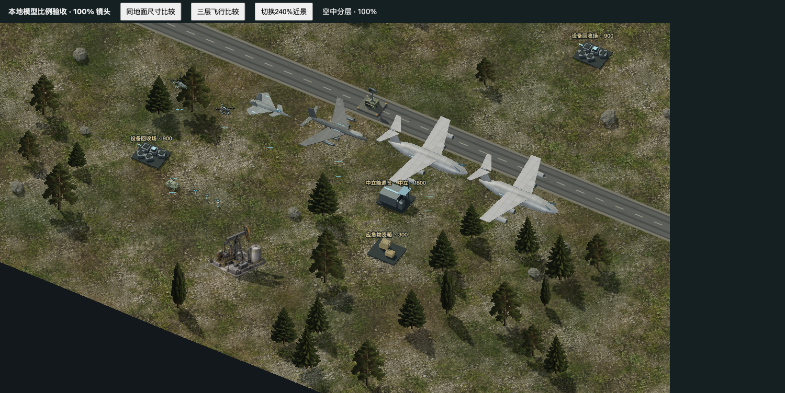
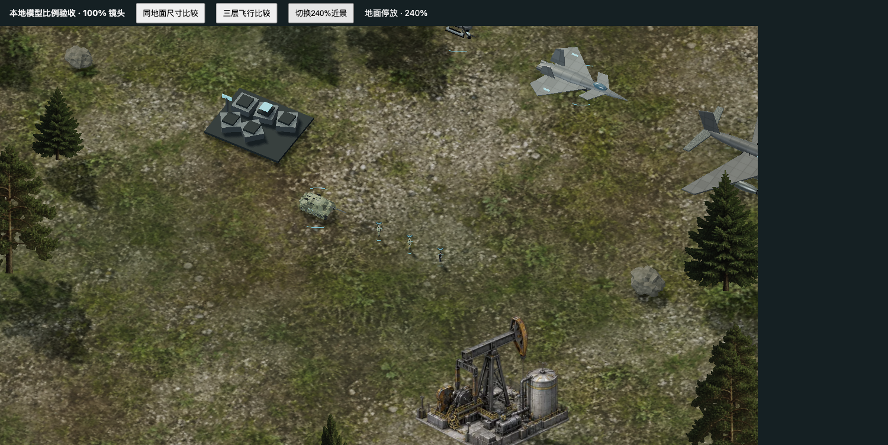

# 三层高度与单位比例调整

本轮采用玩家提供的新 PPT 比例，在100%镜头下协调现代地面、低空与高空单位。游戏展示使用美术尺度，资料中的实物米数用于相对比例参考。

- 人物显示高度约9.68，以1.75米人物与2.4米参考车高的比例校准。参考坦克长度36，人物约为其显示高度的73%。步兵、工程师、侦察员采用同一身高基准。
- 坦克、直升机、战斗机、轰炸机、运输机的停放长度关系为0.5、0.6、1、1.5、2。运输机及补给机空中目标长度由336收至180，战斗机90、轰炸机135；起飞比停放大25%，尺寸连续变化。舰载机保持独立甲板基准。
- 低空无人机26、旋翼42；制空机80、轰炸机100、运输机和补给机112，随地形计算相对高度。双旋翼运输机按低空旋翼处理。
- 人物增大、携行具与头盔提亮，近远景共用轮廓增强。小型队色识别符遵守迷雾、死亡与登载状态。战力、造价和碰撞规则保持原有逻辑。

## 验收

622项自动测试通过。真实页面完成100%开局、三层受控场景与240%人物近景检查；三维场景无异常。敌方步兵进入战争迷雾后模型隐藏，识别符描边数从8降为6。

390px窄屏的页面宽度为390，无横向溢出；实际触摸拖动后存档中的镜头中心发生变化。原离线试玩页的本机游戏存储在验收后恢复。

新离线ZIP为55,413,303字节，SHA256为`a4b550507cd5e74c6075a185f045a647eff17c397255dc647ccf118fe8dd6406`。阻断HTTP/HTTPS请求时，file协议页面仍能进入9单位的单机战场并暂停。此项证明开局不依赖公网资源，不表示联网时不会尝试统计或其他联网功能。

## 发布状态

官网、下载页和默认ZIP说明已更新构建。代码、服务器与公网结果分别回读后填写最终状态。桌面安装包和已送审uTools包仍按各自版本说明提供。
