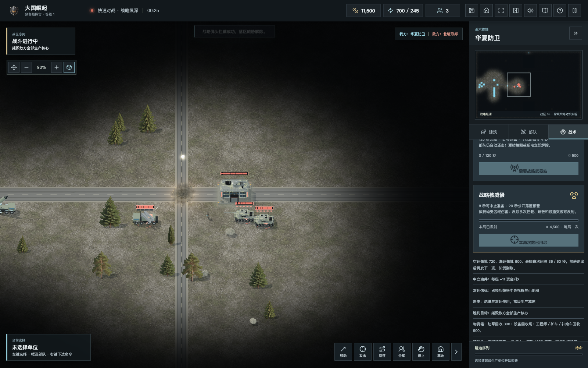
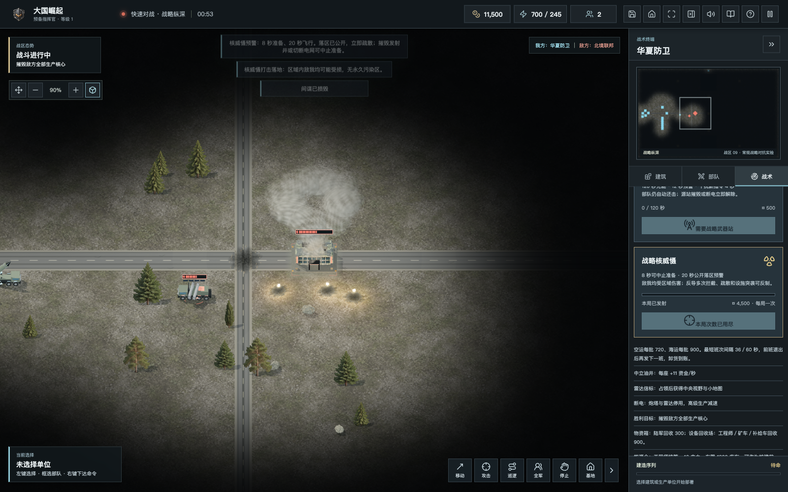
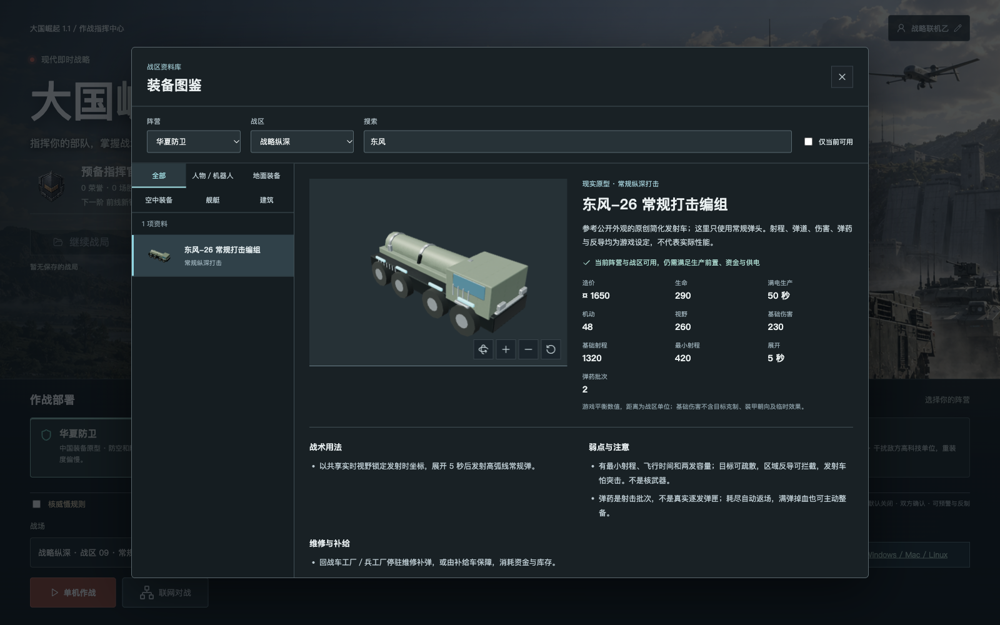
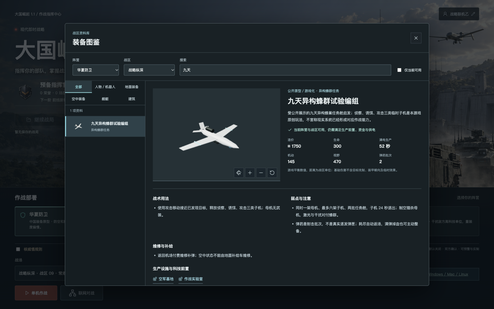

# 1.1.0 战略威慑更新

日期：2026-10-19。本次为走向 2.0 的阶段发行，不是全部路线图完成。发布完成情况与核验信息见文末。

## 新内容

- 新增 6400×4160“战略纵深”：三路推进、侧路、双山体、镜像资源与三个信标，共九张可选战区（含六方专用图）。
- 常规弹道编组、武装直升机、区域反导、机动反卫星侦察、异构任务母机；新增生产职能先限定战略图，五阵营遵守同成本基础规则。
- 东风-26 常规原型、AH-64、F-22 与原创战略装备专属简化三维模型；发射架举升、独立旋翼、发射井双开防爆门、金属／玻璃／涂层分材质。仍不是高精度扫描模型或真实尺寸复刻。
- 默认关闭的核威慑、公开预警、末段反导、准备中止、AI 疏散、有限范围与友伤；中文男女声均增加预警、中止、拦截与落地播报，内置各 73 条。
- 同步纳入本地已有的车辆避让、无人机自主任务、地形接地、情报干扰与图鉴等修正。

## 核规则与反制

全部数值均为虚构游戏规则，不模拟现实核武器性能、结构或操作程序。

| 环节 | 实际规则 |
| --- | --- |
| 启用 | 仅战略纵深，默认关闭；单机主动勾选，双人房间双方确认；六方禁用 |
| 建设 | 实验室前置，战略威慑发射井造价 2400、建造 70 秒、耗电 100；雷达和正常供电必须持续存在 |
| 充能与费用 | 充能 240 秒，发射扣 4500；多座发射井不加速，断电暂停充能 |
| 目标与准备 | 必须是当前可见、地图内落点；准备 8 秒，期间来源被毁或保障失效会中止、不退资金 |
| 公开预警 | 从准备起公开落点、范围及 28 秒总倒计时，含 20 秒飞行；点击警报可定位 |
| 次数 | 每方每局最多实际发射一次；起飞后摧毁井不会删除弹体，被拦截仍消耗次数 |
| 拦截 | 原创反导车依赖雷达、电力、有限弹药与末段覆盖；四次命中才拦截，普通防空／激光／干扰不能代替 |
| 伤害 | 有限范围、距离衰减、包含友伤；满血指挥中心单次最多损失 45%，其他建筑 65% |
| 其他反制 | 侦察突击发射井、打电网、分散与疏散、保护补给；不加入持续污染区 |
| 服务端 | 校验视野、资金、重复命令和次数；预警公开但不附带迷雾内单位和私有准备数据 |

## 实机与图鉴

以下为运行中的游戏截图。为分别检验拦截与落地，使用预置单位、资金和加速的独立受控场景，不是自然完整对局；不代表一局可重复发射。首页背景为原创插画，不能代替实际模型精度。

## 验收与边界

- 347 项自动测试通过，含 12 项威慑规则／模型／特效测试、真实双 WebSocket 核规则确认与指令验证、下载清单；原有后勤、存档、战绩及六方测试一并回归。另有 5 项数据库发布检查回归通过。
- 桌面浏览器 1600×1000 和 1280×800，标准／高画质；预警、四发拦截、落地、图鉴非空且无 WebGL 错误。
- 新版双人协议 4、六方协议 5；旧客户端会被拒绝，请刷新网页或升级客户端，不支持新旧版本混战。
- 真实双浏览器验证双方确认、相同战局、独立席位和坦克移动；GitHub 六个构建任务（含验证与五个平台目标）全部成功，生成九个桌面资产。
- 原有单机存档兼容，旧档默认不开核；新档保存充能、准备和弹体，不重复扣费或发射。
- 全量模型精修、120／240 单位实测性能、弱网长局、真人阵营平衡、国产系统硬件适配仍未完成。六方依旧是自由对战实验入口，不是正式 3v3。
- 联机准备中止、迷雾外拦截的专门语音事件仍待补齐；倒计时和弹体状态已按服务端快照更新，单机已有对应播报。

## 下载与共建

- 在线：https://43.135.186.21:8443/
- 六方实验：https://43.135.186.21:8443/candidate/
- 官网：https://43.135.186.21:8443/official/
- 下载：https://43.135.186.21:8443/downloads/
- GitHub：https://github.com/chencheng666/great-powers-rts
- 发行：https://github.com/chencheng666/great-powers-rts/releases/tag/v1.1.0

离线 ZIP 完整解压后打开 `PLAY.html`；只支持单机，不含联机服务。Tauri 各平台包以下载清单实际资产为准，构建成功不等于所有硬件实测；macOS 未公证、Windows 未代码签名。

感谢 CAI 和持续试玩、认真反馈的玩家。请在 Issues 提供版本、地图、复现步骤和截图，欢迎以清楚授权的原创模型、代码与测试参与共建。

## 发布核验

游戏代码及桌面 CI 的标签基线为 `1557477963b7fe4e81f7af10eaf638cb1af1116b`，发布工具及下载修正已推至 `main` 的 `5cf4e339579d58607fc8b827e655fb10a0cc7059`，后续提交仅补验收文档和测试报告格式。发布期间发现旧双人库缺少六方专用表、离线 ZIP 清单路径遗漏目录前缀；修正不改变游戏模拟或桌面二进制，最终服务端包包含这些修正。

- GitHub 发行已公开，13 个资产：九个桌面文件、离线 ZIP、服务端归档、更新器及校验清单；[自动构建六个任务全部成功](https://github.com/chencheng666/great-powers-rts/actions/runs/39191312281)。
- 双人、六方服务与官网共同切换至 `/opt/great-powers/releases/20261019-v110-r2`；两服务版本均为 1.1.0，协议分别 4、5。
- 完整数据备份保留于 `/opt/great-powers/backups/20261019-v110-r2`；数据库完整性和历史记录比对通过。仅清理本轮有确切编号的八个测试游客与两场测试记录，清理前另作备份，原有玩家和战绩保留。
- 公网双人、六方均完成加入、准备、同局、移动与结算；六方验证单席淘汰不结束整局。双人战略图验证核规则确认与非法发射拒绝。
- 网页、主脚本、官网、下载清单和完整离线 ZIP 的公网 SHA256 与本地一致。下载页十个当前玩家文件、平台筛选、官网新截图、桌面无横向溢出均核验。
- 离线 ZIP：54,859,295 字节（52.32 MiB），SHA256 `3b2fd3479a98791f954a12cab3d94360a46597c558990cafb40c8a60a4b82992`。
- 最终服务端包 SHA256：`18855bbacf5c564a2b3476d27b54f57d79a1dcc3176866e1bc88b2e0ac46e5a2`。
- 首次发布因旧库表结构检查停止后自动回滚；兼容修正经过五项本地数据库回归，再发布成功。未重置密码、未更改 Nginx 或其他端口服务。

可机读的公网结果见 [验收报告](v1.1.0-verification.json)，`null` 表示该模式不适用，不是失败。仍不把构建成功当作所有系统实机通过，也不把短局验收写成弱网或大军团性能达标。
