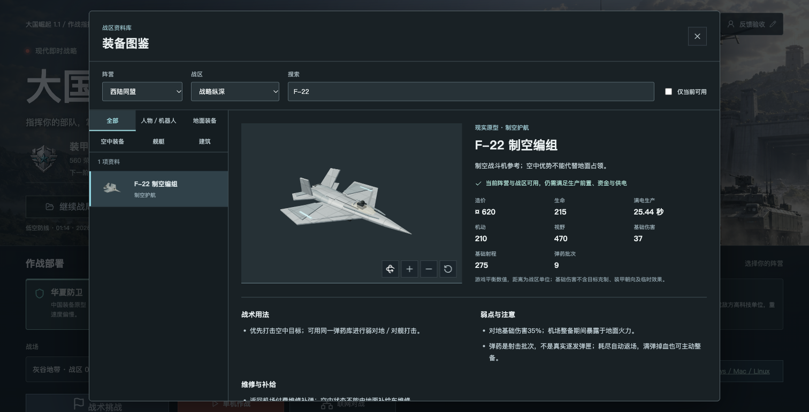
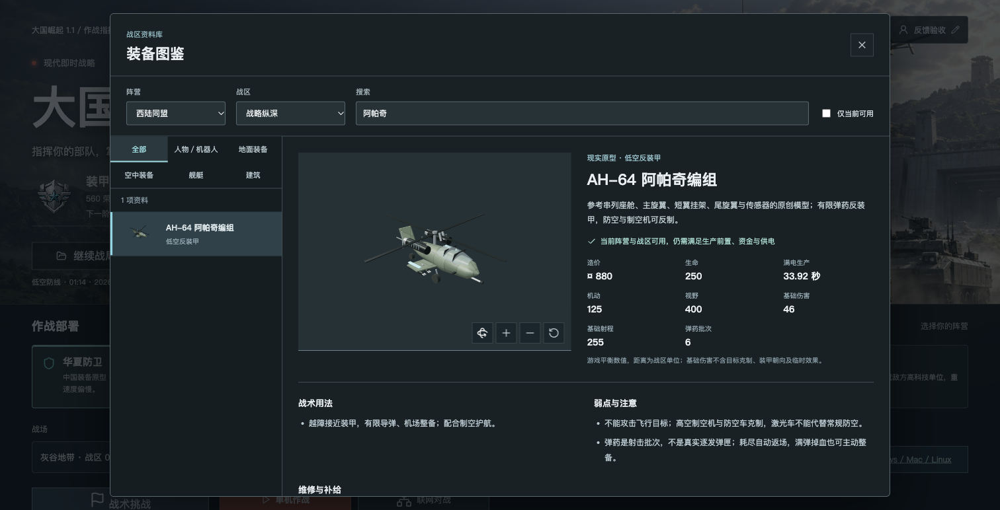

# 1.2.0 战术挑战与模型精修

日期：2026-10-20。走向 2.0 的阶段发行，不是正式 2.0 或整份路线图完工。

## 本次更新

- 四个独立挑战：补给走廊、低空防线、静默回传、抢滩接力。护航、防守、隐蔽采集与海陆协同使用固定编队及有限整备资金。
- 本机挑战成绩档案：最佳星级、独立最快时间、最近战绩、导出与合并导入；不重置旧战局和荣誉，不增加对战属性。
- 连续航点最多追加八段；陆军自由交战、原地警戒、停火；反侦察展开控制与私有指令信息隔离。
- 战后事件时间线、筛选、兵种战损与估算补充成本；这是复盘摘要，不是完整录像。
- 人物迷彩、精模预算与缩放迟滞；F-22 起落架及弹舱、阿帕奇光电／机炮、发射车支撑脚及液压机构；登陆舰防滑甲板、活动跳板与近景载员。
- 范围补给、密集车辆绕行、斜向镜头、建筑地台、飞机蒙皮与机械核预警警报；改善近岸友舰占位造成的尾段抖动，巡逻中不能边航行边卸载。
- 修复混合敌军波次后的挑战存档校验，以及长弹窗旧滚动位置遮挡新结算标题的问题。

## 实机截图

这些是实际游戏界面，不是概念图。登陆关由真实运输、卸载、交火、工程师接管与驻守完成；验收为加速推进模拟，未瞬移、清敌或修改生命值。

## 验收与边界

- 442 项自动测试通过；包含真实 WebSocket 双人与六方会话、指令权限、情报隔离、存档、挑战档案及显示预算。
- 桌面浏览器验证了正常通关、失败重试和读档渲染；1600／1280 宽度无横向溢出，WebGL 无错误。
- 登陆舰载员采用远近切换和数量预算，不保证所有显卡或大规模舰队的帧率。
- 六方仍为自由对战实验入口，不是 3v3 或排位；微信登录、云荣誉、完整录像、连续战役与国产硬件长局验证尚未完成。
- 旧单机档案和普通荣誉不重置；建议升级前导出战局、荣誉与挑战档案备份。历史 Windows 抖动反馈仍需原设备复测，不因本地验收自动关闭。
- Tauri 构建成功不等于各平台实机验证；Mac 未公证、Windows 未签名，Linux 仍需匹配 WebKitGTK／WebGL2 和硬件架构。

## 下载入口

- GitHub 源码：https://github.com/chencheng666/great-powers-rts
- 本版发行：https://github.com/chencheng666/great-powers-rts/releases/tag/v1.2.0
- 在线试玩：https://43.135.186.21:8443/
- 六方实验：https://43.135.186.21:8443/candidate/
- 官网：https://43.135.186.21:8443/official/
- 下载中心：https://43.135.186.21:8443/downloads/

## 发布结果

- 游戏标签 `v1.2.0` 固定在 `eea2b4be1df2814ba0a9479c4fb51cbf3ee02321`；服务端归档构建来源为 `1f0ddc7afb92f8074d563d55ea93670afe467004`，后续仅补充发布工具、下载清单、文档与验收，不移动游戏标签。
- [桌面构建](https://github.com/chencheng666/great-powers-rts/actions/runs/39405357672)的验证及五个平台任务全部成功，生成九个桌面文件。[网页和服务端发布](https://github.com/chencheng666/great-powers-rts/actions/runs/39407868039)再次完成 442 项测试、构建、资产上传与校验。
- GitHub 公开发行共 13 个资产：九个桌面文件、离线 ZIP、服务端归档、更新脚本及 SHA256 清单。初次本地上传与桌面构建创建发行发生冲突后，改由统一流程完成；没有保留重复的未完成草稿。
- 双人、六方与官网共同切换至 `/opt/great-powers/releases/20261020-v120`；版本均为 1.2.0，协议分别为 4、5。更新前确认无玩家房间与对局，不修改其他端口、Nginx 或账号密码。
- 发布备份为 `/opt/great-powers/backups/20261020-v120`，含两个数据目录与旧链接。数据库完整性和历史记录比对通过，真实玩家数据保留；只按本轮确切测试编号清理验收游客及测试对局，清理前另有备份。
- 公网真实双人／六方会话完成建房、准备、同局、移动、三种交战姿态、追加及清空航点、敌方越权拒绝和结算；双人验证核规则确认与非法发射拒绝，六方验证单席淘汰不结束整局。
- 网页入口、主脚本、官网及下载清单与本地构建全文件 SHA256 一致；下载中心十个当前文件及 Windows／Mac／Linux／离线筛选正常，官网四张本轮图片已实际加载。
- ZIP 在本地完整下载并校验；公网完成 HEAD 大小及 HTTP 206 的 64 KiB 分段校验。跨境整包下载曾超时，不将分段验证写成公网整包下载成功。服务器文件另作完整 SHA256 核验。
- 本地离线 HTML 已在真实浏览器从 `file://` 打开并运行“抢滩接力”，无外部 HTTP 请求、无 WebGL 错误，玩家存档与荣誉原值未变；公开 ZIP 内的 `PLAY.html` 与该验收文件哈希相同。

| 文件 | 大小（字节） | SHA256 |
| --- | --- | --- |
| Great-Powers-RTS-v1.2.0.zip | 54,842,094 | `e468d2ed806236cd1f15ae77f7d1024420d0ecc69271c0f10067ce749cc3907a` |
| great-powers-server-v1.2.0.tar.gz | 125,575,095 | `8561a88899606b625487de3ee31e071d251440724dfe12b7a20cc020367c4fc9` |

可机读的公网结果见 [验收报告](v1.2.0-verification.json)。`mode: range` 是分段，不是整包；`null` 是该模式不适用。构建及短局通过不代替弱网长局、国产硬件、大军团性能或真人平衡测试。
