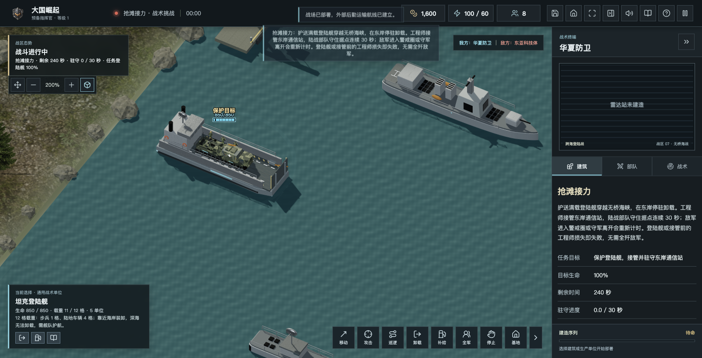
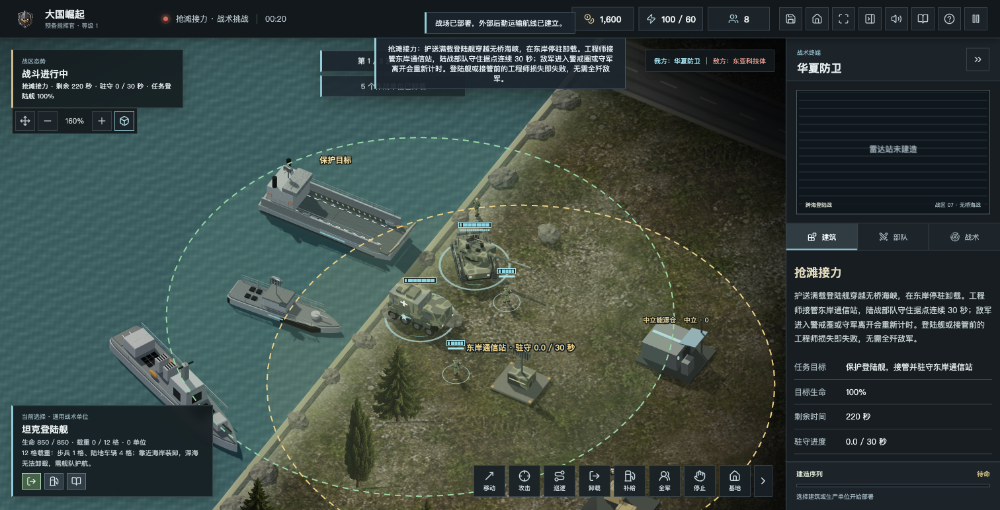
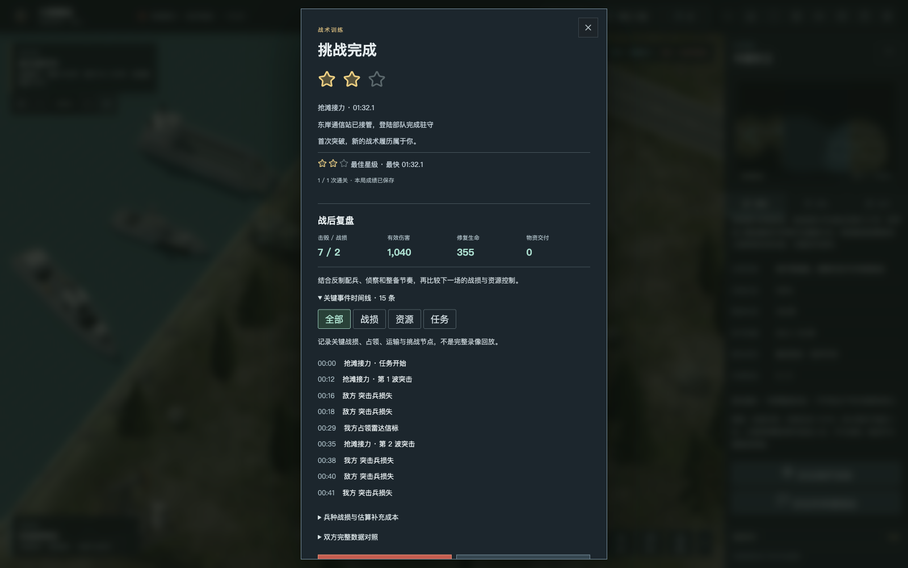

# 1.2.0 战术挑战与模型精修

日期：2026-10-20。走向 2.0 的阶段发行，不是正式 2.0 或整份路线图完工。

## 本次更新

- 四个独立挑战：补给走廊、低空防线、静默回传、抢滩接力。护航、防守、隐蔽采集与海陆协同使用固定编队及有限整备资金。
- 本机挑战成绩档案：最佳星级、独立最快时间、最近战绩、导出与合并导入；不重置旧战局和荣誉，不增加对战属性。
- 连续航点最多追加八段；陆军自由交战、原地警戒、停火；反侦察展开控制与私有指令信息隔离。
- 战后事件时间线、筛选、兵种战损与估算补充成本；这是复盘摘要，不是完整录像。
- 人物迷彩、精模预算与缩放迟滞；F-22 起落架及弹舱、阿帕奇光电／机炮、发射车支撑脚及液压机构；登陆舰防滑甲板、活动跳板与近景载员。
- 范围补给、密集车辆绕行、斜向镜头、建筑地台、飞机蒙皮与机械核预警警报；改善近岸友舰占位造成的尾段抖动，巡逻中不能边航行边卸载。
- 修复混合敌军波次后的挑战存档校验，以及长弹窗旧滚动位置遮挡新结算标题的问题。

## 实机截图

这些是实际游戏界面，不是概念图。登陆关由真实运输、卸载、交火、工程师接管与驻守完成；验收为加速推进模拟，未瞬移、清敌或修改生命值。

## 验收与边界

- 442 项自动测试通过；包含真实 WebSocket 双人与六方会话、指令权限、情报隔离、存档、挑战档案及显示预算。
- 桌面浏览器验证了正常通关、失败重试和读档渲染；1600／1280 宽度无横向溢出，WebGL 无错误。
- 登陆舰载员采用远近切换和数量预算，不保证所有显卡或大规模舰队的帧率。
- 六方仍为自由对战实验入口，不是 3v3 或排位；微信登录、云荣誉、完整录像、连续战役与国产硬件长局验证尚未完成。
- 旧单机档案和普通荣誉不重置；建议升级前导出战局、荣誉与挑战档案备份。历史 Windows 抖动反馈仍需原设备复测，不因本地验收自动关闭。
- Tauri 构建成功不等于各平台实机验证；Mac 未公证、Windows 未签名，Linux 仍需匹配 WebKitGTK／WebGL2 和硬件架构。

## 下载入口

- GitHub 源码：https://github.com/chencheng666/great-powers-rts
- 本版发行：https://github.com/chencheng666/great-powers-rts/releases/tag/v1.2.0
- 在线试玩：https://43.135.186.21:8443/
- 六方实验：https://43.135.186.21:8443/candidate/
- 官网：https://43.135.186.21:8443/official/
- 下载中心：https://43.135.186.21:8443/downloads/

## 发布状态

发布进行中：源码、离线 ZIP、各平台桌面文件、服务端归档和公网部署分别核验后补充结果。当前不能仅凭源码版本号认定公网已更新。

腾讯云网页终端本次需要重新登录；未重置服务器密码，未改动现有玩家数据库。
