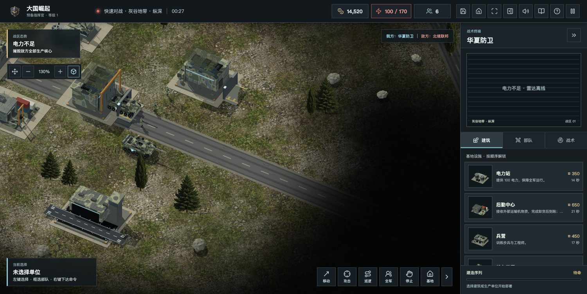

# 1.2.1 国内战区与 CAI 反馈修复

## 本轮范围

依据 CAI 的十页《地图建筑物篇》逐项核对。材料中的比较截图仅用于定位问题，不进入游戏素材库。

| 反馈 | 本版处理 | 边界 |
| --- | --- | --- |
| 游戏名称与背景表述 | 保留现名，强调原创虚构对战与防卫题材 | 不以装备胜负对应现实国家，不擅自改名；后续继续征集命名意见 |
| 概念封面与实际效果差距大 | 主菜单改用当前引擎实机画面，官网使用实机图 | 截图为受控测试场景，不伪称真人对局 |
| 导入文件按钮含义不明 | 增加“导入存档”，与相邻按钮统一高度和宽度规则 | 不改原存档键，不重置荣誉 |
| 现代与未来建筑混杂 | 现代兵营、工厂、兵工厂按自身正门对齐出口，缩短外部装卸铺装 | 未宣称所有模型完成写实重建；月表继续保留未来风格 |
| 地面偏暗、树影不清 | 常规地表适度提亮和增加植被饱和度，保留已有实体阴影及45度俯角 | 不是简单全局加曝，月表单独保留灰度基调 |
| 无意义道路、黄色圆盘 | 删除陆图额外的斜穿装饰公路，现代建筑改为分缝混凝土基座 | 主干道仍是地图参照，不提供隐藏移速加成；未来设施保留圆形结构 |
| 海岸太直、缺少滩涂 | 增加不规则宽度沙质岸带与潮线 | 不改变海陆碰撞边界，尚未完成任意形状海岸地形重构 |
| 工厂门口与实际出车方向不一致 | 统一模型、建造预览、门口铺装与生产方向，覆盖镜像及六方角度 | 不添加不经验证的任意建筑旋转操作 |
| 树木、石头穿模 | 修正迷雾刷新时岩石丢失地形高度，施工清理完整基座，经过的地面单位周围暂隐装饰物 | 装饰树石不变成新障碍，不暗中改变寻路和公平性 |
| 机场与飞机、跑道只是装饰 | 固定翼从跑道端部沿轴线驶出并抬升，返场目标改为停机坪，不再直指机库中心 | 完整进场下滑线、滑行队列、多泊位调度与飞机比例重制仍在计划中 |

## 国内部署

- 官网：https://www.daguojueqi.site/
- 单机及双人：https://www.daguojueqi.site/play/
- 六方实验：https://www.daguojueqi.site/candidate/
- 下载中心：https://www.daguojueqi.site/downloads/
- 原个人网站：https://www.daguojueqi.site/resume/
- 源码：https://github.com/chencheng666/great-powers-rts

前后端部署在上海独立实例。沿用已有 TLS 证书，同域 HTTPS API 与 WSS 对战，双人和六方使用独立服务、账户库及 Cookie。旧海外服务不删除，不迁移或混用历史账号库。

部署前备份原站文件和虚拟主机配置。发布状态以同目录核验记录为准，不能只凭构建成功判定上线。

## 测试与素材

自动回归已通过 446 项。实机场景检查包含工厂出车方向、基座、机场施工清理及画布像素非空；不把绘制调用数当作真人大军团帧率。

桌面各平台构建结果、域名 WSS 联机、下载全文件哈希及原个人站可用性，须在发布后核验并补录。
