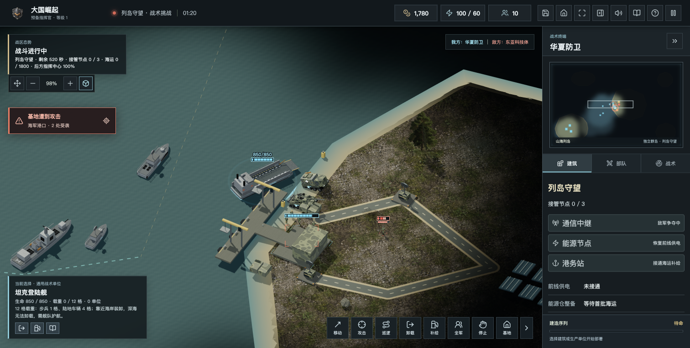
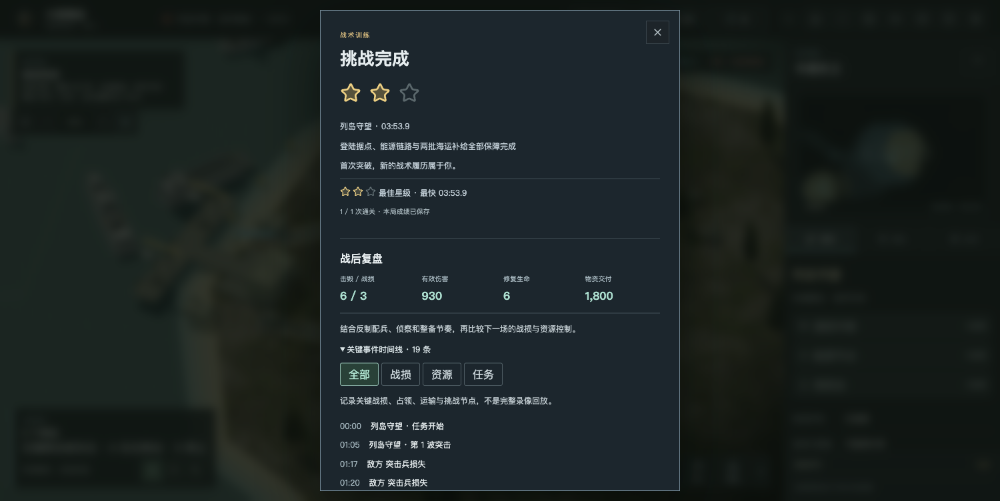

# 1.3.0 山海防线先行版

此版已由 1.3.1 修订版取代：最终公网验收发现首次素材未就绪时打开挑战会异常，修订版改为先显示任务、随后加载缩略图并接管失败提示。请使用 [最新发行](v1.3.1.md)。

这次先把“登陆、占领、供电、海运与整备”做成可玩的闭环。不是正式 2.0，九大战区、侧翼岛机场争夺、多岛扩张与后续战役仍在开发。

## 新增内容

- **列岛守望：**独立 4480×3200 五岛地图，无陆桥；舰船绕岛、陆军不走海。满载登陆舰靠近西侧沙滩后按 U 分批卸载，再按 U 可取消。工程师持续接管通信、能源、港务，每站 6 秒且可重复使用。敌军独占节点 12 秒会切断链路，可夺回。恢复供电并接通节点后护送两批物资，再驻守 20 秒通关。
- **运输支撑前线：**本关每批海运 900、最多派出 5 批；有效抵港才结算。断电、节点失守与受袭分别提示，不重复领钱。首批抵港后能源仓可付费维修补弹、补充补给车库存；陆军不会尝试跨海走回后方工厂。
- **深蓝生命线试航：**海运累计 2700，首船损失可以补发；双港改派、下一班航道、暂停派船与有限恢复金。每港两处军舰维修泊位，货运、维修与登陆位置错开。
- **表现：**三维岸带、真实细颗粒地表、能源阵列、沙滩标柱、港口和货箱材质、空载货船返航；活动跳板与原有重点模型细节保留。
- **延续旧功能：**旧四关挑战、最佳成绩、存档与复盘、图鉴、中文男女声、游客双人及六方实验保持可用。新群岛目前只开放单机任务，不把不对称关卡当成竞技地图。

## 验收

- 468 项自动测试通过，包含两条航道、三组正常指令通关、卸载中途存取及首批海运后读档续战；旧存档与联机规则同时回归。
- 浏览器实际选择登陆舰、右键航行、按 U 卸载，正常指令接管三节点并完成两批交付及驻守：03:53.9 通关、两星、成绩保存。WebGL 读取到 7099 种采样颜色，错误码 0，无脚本错误。颜色采样只证明画面非空，不代表全平台画质或性能保证。
- 网页生产构建通过；离线 ZIP 已生成并校验完整性。离线运行、下载、桌面 CI 与线上服务分别记录，不用构建替代实际发布验收。

## 入口

- 官网：https://www.daguojueqi.site/
- 单机及双人：https://www.daguojueqi.site/play/
- 六方实验：https://www.daguojueqi.site/candidate/
- 下载中心：https://www.daguojueqi.site/downloads/
- 国内免安装 ZIP：https://www.daguojueqi.site/downloads/packages/Great-Powers-RTS-v1.3.0.zip
- GitHub：https://github.com/chencheng666/great-powers-rts/releases/tag/v1.3.0

地址为本次发行目标，是否已更新以 [逐项发布核验](v1.3.0-verification.json) 为准。

## 边界与共建

群岛新关暂不支持双人、六方或合作。深蓝试航仍使用旧无桥海峡原型；五岛首关也不等于完整多岛战役。弱网长局、麒麟／UOS 具体硬件、全量精模与 120／240 单位目标帧率仍需验证。Mac 未公证，Windows 未签名。

按玩家建议，后续重点模型优先复用授权清楚的社区资产，再进行减面、材质、动作与离线适配。当前外部模型仍为候选，没有把红警原版提取网格混入公开包；详见 [社区资产复用清单](../2.0社区资产复用清单-20261022.md)。

感谢 CAI 和持续试玩、提交有效建议的玩家。欢迎在 GitHub Issues 中提供版本、地图、系统、复现步骤及截图，一起把游戏打磨到 2.0。
