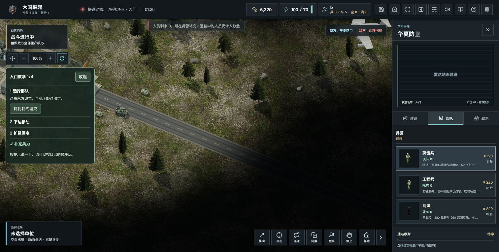
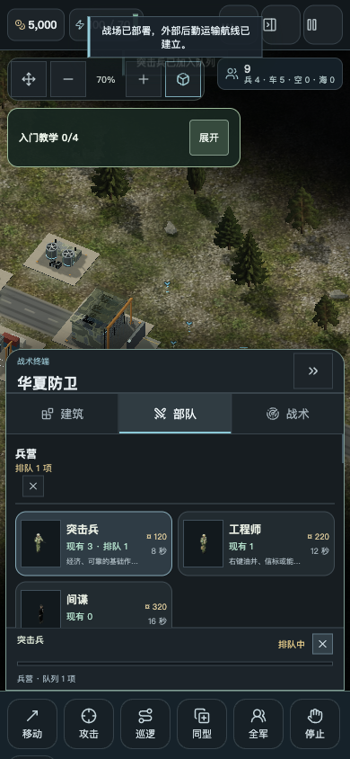

# 2.0.3 配乐、桌面更新与生产提示

2026年11月3日。针对五项粉丝体验反馈，包含此前的三层比例与补给巡逻修复。

- 更换原创战斗配乐《钢铁洪流》，132BPM，约58秒，鼓点、失真低音和铜管加强。游戏内128kbps AAC为892,097字节，比原配乐1,359,281字节小约34%。FLAC母版4,515,187字节，相对16位立体声WAV减少约56%，解码还原PCM完全一致；AAC是有损分发格式，不能称为无损压缩。母版可从本次GitHub发行附件单独获取，不打入游戏包。
- 桌面版首页启动时检查公开版本元数据，新增“检查更新”，发现新版显示版本与说明，并可打开固定官网下载入口。联网失败可手动重试，不阻挡离线单机。本次没有实现安装包静默覆盖或签名自动升级；旧版需安装2.0.3一次，之后才有提示。版本比较按数字，不执行远端HTML，不接收任意下载URL，不上传存档、姓名或荣誉。
- 右侧部队生产组显示各生产线当前单位与真实剩余时间；卡片显示现有、并行生产与排队数量。建筑卡片显示建造倒计时与待部署状态。持续刷新只更新文字，保留滚动位置和焦点；暂停、缺钱及适用的缺电暂停有明确状态。
- “就绪”等战场提示仍水平居中，桌面与手机均向战场顶部移动，避开主要交火区域；不改变地图目标或胜负规则。
- 顶部拆分人员、车辆、空军和海军，人员归零时提醒补充；右侧各型号数量随损失／生产变化。运输中的存活乘员仍计数，阵亡与自动物流不计数；不会把驻站消耗等原因误说成全部战死。

## 验证

629项Node自动测试通过。覆盖多人生产线、实际生产时间、暂停与取消、乘员计数、损失归零、版本比较、更新信息限制与元数据CORS隔离，原有存档、联机、反馈鉴权与数据保存回归通过。网页和离线ZIP构建通过，ZIP完整性检查通过。

实机：新配乐解码约58.18秒，AudioContext运行；排队→倒计时→现有数量增加，人员归零提示正常。390px无横向溢出，生产栏和分项数量可见。阻断HTTP/HTTPS后的离线包可开局并进入生产栏。受控更新页验证“发现新版／当前最新／联网失败重试”和打开下载入口；这些是逻辑验收，不冒充所有原生平台实测。

本机默认Rust1.61及旧镜像配置不符合本项目要求，首次本地Rust测试未运行成功；使用独立现代工具链继续核查，桌面各平台构建以本次GitHub CI实际结果为准，不修改用户全局Cargo配置。

## 桌面构建

GitHub CI `41631862921`完成五个平台构建：Windows x64、macOS Apple Silicon／Intel、Linux x64／ARM64，共9个安装资产。下载清单从发行API读取实际大小和SHA256，未把CI成功等同于所有系统实机兼容。
