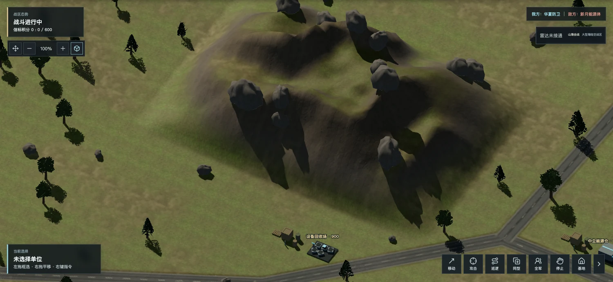
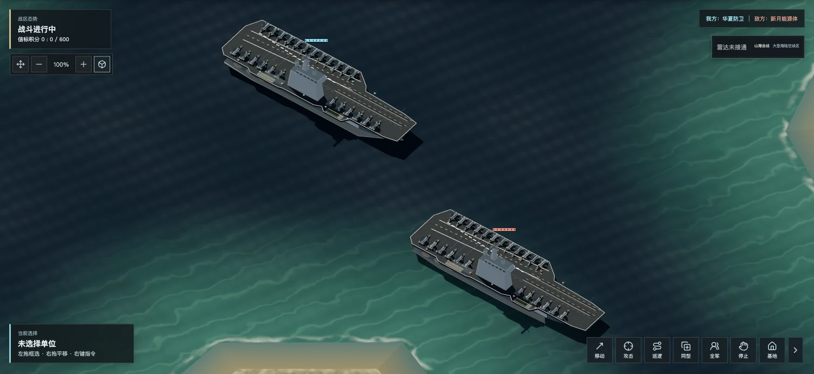
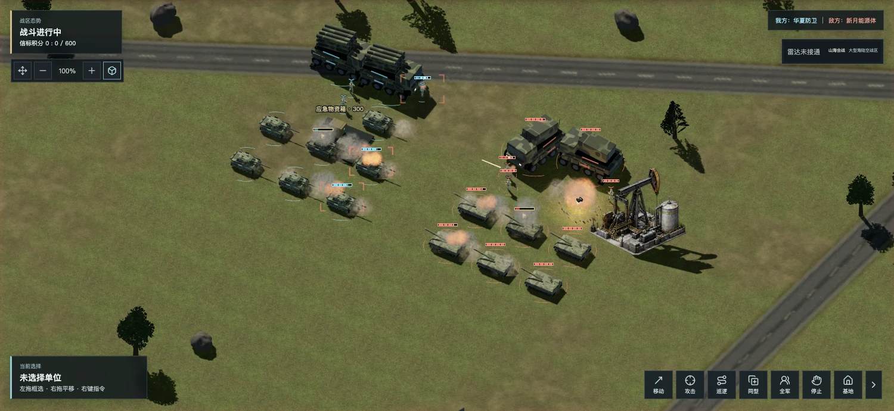

# 网页3.6.0：三维写实重制

构建号：`20261111-realism-r1`。2026年11月11日已发布官网、双人和六方对战服务；发行源码提交为`3db669f008b60f55753019433eafbe4be2a6d17d`，以发行包`release.json`为准。

## 这次改变

地形从圆滑山包改为连续峰脊和沟谷，普通谷地与海岸的山丘也加入多尺度侵蚀。岩壁使用三平面摄影材质，草地、砂土、湿沙、积雪和厂区道路分别处理；月表保留独立陨坑，并细化月壤法线与粗糙度。CPU地面、GPU贴花使用一致整数噪声。

室外天空环境替换室内灯箱反射，统一人物、车辆、航空、舰船与设施质感，保留兵种与阵营的区别、选取和动态关节。车辆随坡面俯仰、横滚和刹车载荷平滑变化。风化岩块与近景立体叶簇不再使用同一套低细节外观；团战、低画质负载和触屏降级互不叠影。

海面与舰艇姿态使用同源长波；深浅水、近岸泡沫与微波分层。精细档小规模场景使用512像素平面反射，至少间隔120毫秒更新；移动端、降分辨率和密集战场不额外反射。镜像中排除选择圈与阵营辅助标记。

炮口尘、扬尘、损伤黑烟和爆炸热焰使用固定容量三维噪声烟团；导弹和火箭从相邻真实弹体位置连接连续尾烟。保留已有火焰、碎片、冲击波、后坐与贴坡焦痕，不改齐射总伤害。修复后熄烟，烟尘遵守迷雾和来源可见性。

武器与爆炸增加一次共享短卷积早反射，随山地、厂区与海域改变返回量，月表关闭。配乐、无线电与移动声不进入这条卷积。原有声部上限和静音设置保留。

## 实机

以下为受控实机；部分暂停、揭开迷雾或摆放单位用于验收，不是概念图、在线玩家统计或全程录像。

## 验证

- Node全量721项通过，生产构建通过。新覆盖纹理预算、山体边界、海岸距离、海浪、烟团和尾烟容量、阴影/纹理释放、悬挂、标记合批、短卷积与触屏重排预算。
- 生产构建的本地浏览器逐项打开灰谷入门、山海会战、寒境、工业、月海与六方地图；地图标识与任务初始化对应，着色器错误0、上下文未丢失。连续切换已复核。先前快速切换发现的释放问题已补阴影/共享资源释放、原生画布回收及退局GPU清理。
- 两艘航母分别显示24个有效停机模型；精细反射强度启用，辅助标记未进入镜像。七款航空曲面及对应停机模板延续上一版，未重新载入历史退役外形。
- GPU浮点采样与CPU山体高度五点对比，最大差约0.000061世界单位；山体仍在原阻挡内，谷道和寻路规则保持独立。
- 同机、同1176×690视口、180单位静态渲染对照：旧版中位33.3ms/P95 41.8ms，新版33.4ms/41.7ms；三维自适应比例均0.65。末帧同为非阴影更新帧，绘制调用365→186。该测量是冻结模拟的渲染场景，不能称完整团战或60FPS。
- 独立实际交火：180单位起始，约10.83秒模拟后剩123单位，帧耗时中位33.4ms/P95 42.8ms；峰值320烟团、720尾烟段、39弹体，达到容量后不增长；错误0。结果仅代表本机开发场景，设备与浏览器不同会变化。
- 844×390、DPR2触屏模拟：无横向溢出；高画质三维像素比例上限1.5、2048阴影、140烟团/280尾烟段，额外反射和SSAO关闭、树冠轻量，三维地形31175顶点。文字与血条保留独立高分屏画布。这不是手机真机性能或国产桌面兼容报告。
- 真实WebAudio已建立一个双声道短卷积，48kHz设备下23040采样；干湿分支与月表关闭有独立测试。不将程序混响称为实录交响乐。

## 生产回读

- 上海服务器使用既有发布流程完成备份、预检和切换，286项文件摘要校验通过。官网、`/official/`、`/play/`、`/candidate/`及新增媒体与发行包一致；双人、六方服务均回报3.6.0和本次构建号，协议分别为6、7。
- 6个玩家数据库完整性检查正常，对照发布前备份，各表记录数未减少。独立科幻版、下载清单及个人站等7个保留入口摘要未变。
- 在生产网页实际进入山海会战，精细立体视角的山体、地表与海面正常；受控造景的航母显示24个有效停机模型，调用实际调度后为6架出动、18架留在甲板。着色器错误0、图形上下文未丢失。测试保持战局暂停，没有制造胜负结果；测试触及的7项本地存档和设置已逐项恢复并比较一致。
- 本地验收报告、受控造景和截图保留在忽略的`qa/realism-20261111/`目录，不作为玩家运营数据发布。

## 资产和边界

新增Poly Haven摄影草地/岩壁派生图四张，共534,646字节，CC0；作者与修改见根目录第三方清单及同目录来源JSON。颜色/法线/粗糙度/遮蔽使用共享数组，摄影图失败回退程序层；运行时不访问第三方CDN。新增官网实机图片单列媒体。

这是网页和共用对战服务的表现更新。玩家账号、战绩、统计库、历史安装包、独立科幻版与个人站保留。商店包和平台审核维持各自状态，没有把3.6写成4.0玩法完成版、真实装备仿真或3A成品。

技术依据与覆盖清单见[三维写实重制与几猫深剖](../plans/三维写实重制与几猫深剖-20261111.md)。
