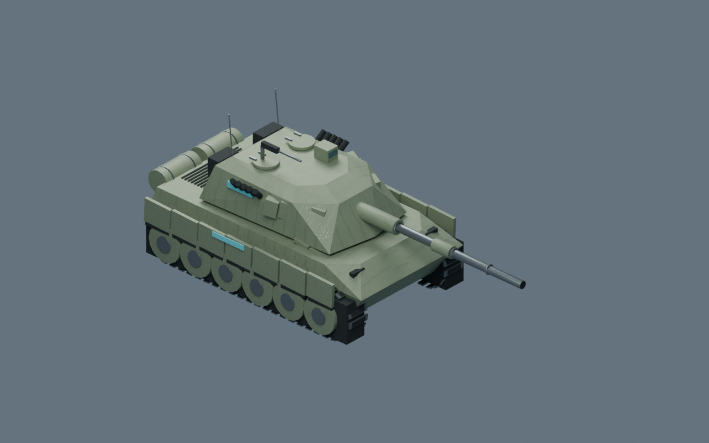
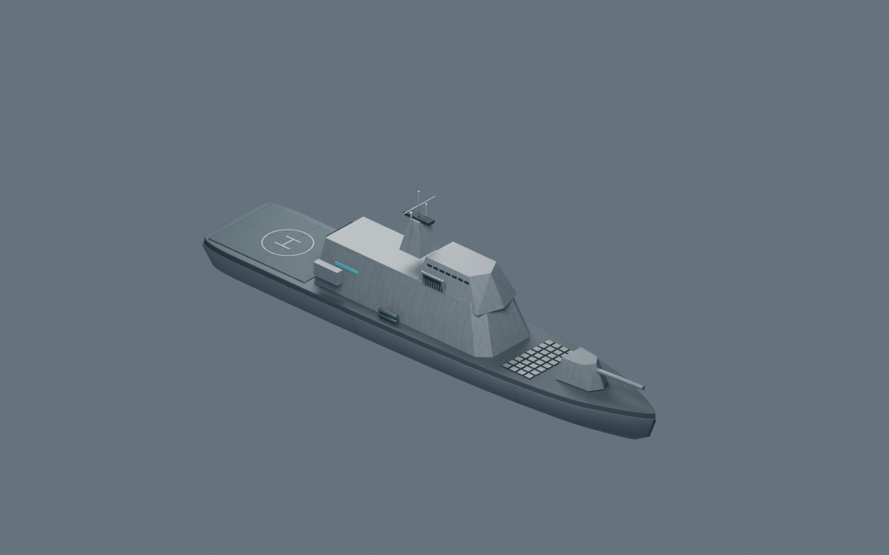
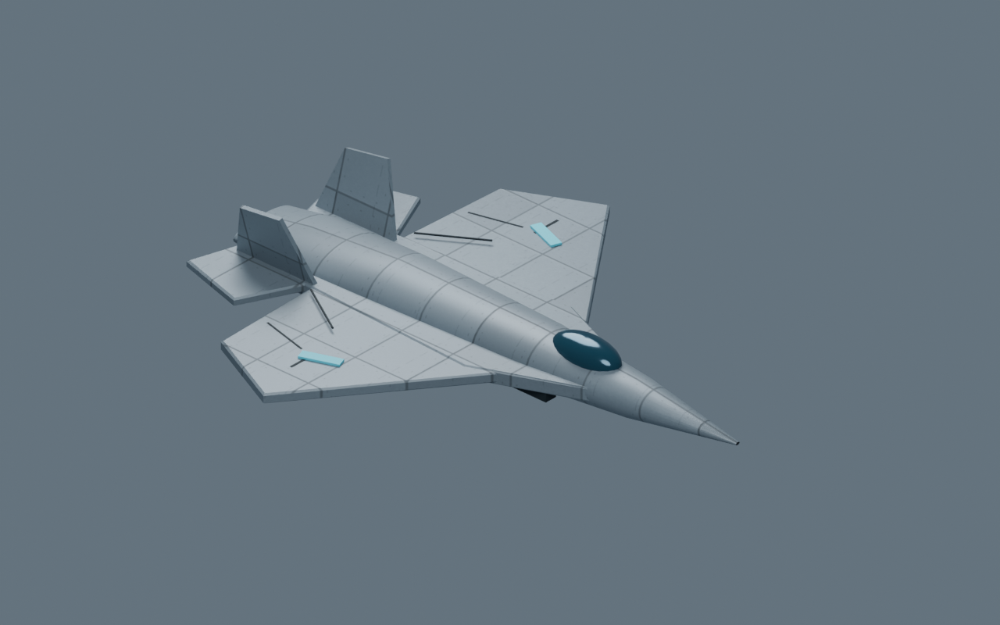
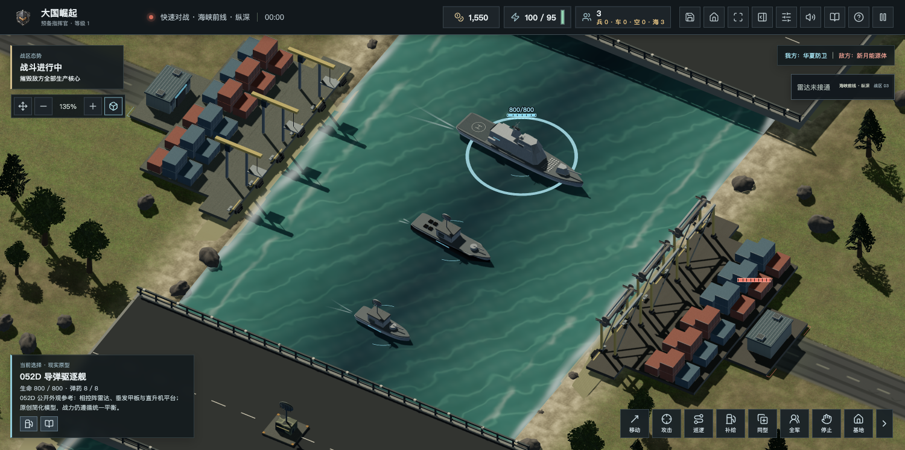

# 3.6.3：程序化模型与 Blender 5.3 检查

网页构建：`20261113-procedural-polish-r1`。源码和模型验收于2026年11月13日完成；生产和下载结果以本文末尾的实测记录为准。

## 模型与缓冲

- 华夏坦克：增加首部分层装甲、检修盖板、灯具底座、炮塔储物架和舱盖铰链。全部复用原材质并合批，炮塔、炮管、炮口与循环履带层级保留。模板4518三角形，显示循环履带实例后7014三角形，17个可见材质批次，与改动前相同。
- 六种通用舰体：沿贝塞尔轮廓分层放样，上缘、折角水线和收窄舰底分开，顶盖与底盖保留平面法线。驱逐舰模板从6288降至5128三角形，12个可见批次不变。
- 七种程序飞机：近景新增翼面舵缝和喷口加强环，远景与停机模型不增加这些细节；原近远景预算和24个折翼机位验收继续通过。
- 程序模型合批后按位置、法线、UV共同去重，生成索引。保持逐三角形位置、硬边和纹理接缝，不跨材质或关节合并。九款重点模板同口径几何缓冲减少45%—58%；这只是几何属性及索引字节，不包括贴图、帧缓冲和整机内存，也不代表帧率同比提升。基线为64f28d4，比较采用同一个导出脚本，包含近远两级并去除重复缓冲。

| 模型 | 原几何字节 | 本版几何字节 | 可见批次 |
| --- | ---: | ---: | ---: |
| 华夏坦克 | 405456 | 199508 | 17 |
| 华夏驱逐舰 | 603648 | 330608 | 12 |
| 华夏隐身舰载机 | 208896 | 99264 | 4 |
| 重型电子战机 | 314880 | 135840 | 4 |

## Blender 流程

本机由5.2.1 LTS升级为官方5.3.0，旧应用保留为`/Applications/Blender 5.2.1 LTS.app`。安装包从阿里云镜像下载，与Blender官方SHA256清单一致，并通过应用签名完整性验证。该工具升级不属于玩家运行依赖。

`node scripts/export-procedural-audit.mjs qa/procedural-audit`导出实际JavaScript生成的模型；`Blender --background --factory-startup --python scripts/audit-procedural-blender.py -- qa/procedural-audit`在独立场景重建层级、实例、UV、材质和程序纹理，生成检查图、blend和JSON报告。三款重点模型的检查为无效坐标0、退化三角形0。Blender检查图是受控模型渲染，不是对局截图。

游戏继续动态生成模型，没有新增高斯泼溅资源或外部生成服务；本轮新增造型均为原创代码，没有新增第三方素材许可。

## 验收边界

736项回归通过；新增合批逐三角形等价检查及舰体收窄、法线和确定性检查。网页构建通过。浏览器实机检查、离线包、桌面CI和生产回读在完成后补充。

本地浏览器7项回归通过：坦克与人物点选、实际行走123.65世界单位、循环履带两侧独立动画、右键攻击并命中、炮塔旋转、70%战术与160%立体视角选取。脚本错误0，图形上下文正常。离线ZIP已构建并通过压缩完整性校验，实际离线开局另行记录。

离线验证：`file://`下启用断网，3.6.3进入真实单机战场，脚本错误0、外置脚本0、外置样式0。测试前后9项本机游戏记录逐项恢复一致。海峡实机场景的驱逐舰、护卫舰和巡逻艇均使用第二版舰体，动态关节存在、图形上下文正常。

## 本版画面

以下三图为实际程序生成几何在Blender5.3中的受控检查渲染，最后一图为游戏引擎受控海峡场景；不是连续真人对局。

分发构建：GitHub Actions `43369462531` 的完整回归、网页构建及五个平台桌面任务均成功，九件桌面文件取得GitHub公开大小与SHA256。原版当前区包含新版离线ZIP及九件桌面文件；历史包、uTools和独立科幻渠道版本继续保留，不代表商店同步升级。

## 11月13日生产结果

官网和上海双人/六方服务已更新为`20261113-procedural-polish-r1`，部署源码为`738abf287263c2ee0de5effa64d7cdf8f1c24a9b`。发布前再次确认无房间、无对局；287项资源由部署脚本逐项核对，13个关键公网文件与本地构建摘要一致，两个服务健康检查通过。

备份位于`/opt/great-powers/backups/20261113-procedural-polish-r1`。6个数据库完整性正常，各表历史数量均未减少。6个独立入口（含个人站点及独立游戏）摘要保持一致。线上7项点选、实际移动123.65世界单位、履带与炮塔、开火命中及缩放选取回归通过，脚本错误0、图形上下文正常，测试后本机记录逐项恢复。

两个官网域名均为3.6.3；首页读取统一清单，下载页当前区10项、独立渠道2项、历史区81项。原有83条文件记录的地址、大小和摘要全部保留。官网ZIP完整下载62,443,781字节，SHA256为`dddb1a3c114ab4ea382c536bf12849ee39ae0a484dfd2c1db54e338d9d5e98ca`。桌面文件由GitHub提供，对应硬件与商店渠道保持各自验收边界。

本轮公网冷启动素材下载较慢，部分地表材质耗时约11—20秒，完整模型准备超过默认10秒测试等待；继续等待后正常进入战场。该网络条件下的首载速度仍需后续专门优化，不能用本轮几何缓冲节省宣称网络首载加快。

GitHub分发补充：九件桌面文件、服务器补丁包与SHA256清单已公开；本机直传62MB离线ZIP到GitHub镜像时写入超时，未将缺失镜像标为成功。离线ZIP以已完整回读的官网地址为准。仅删除本轮确认无资产的临时草稿，公开发行保留。
