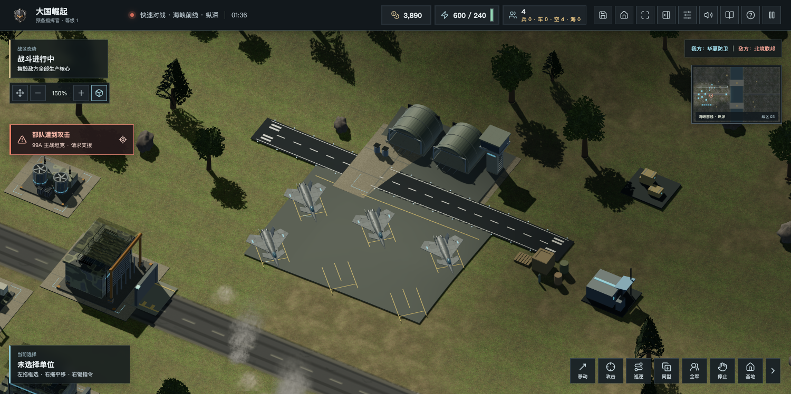
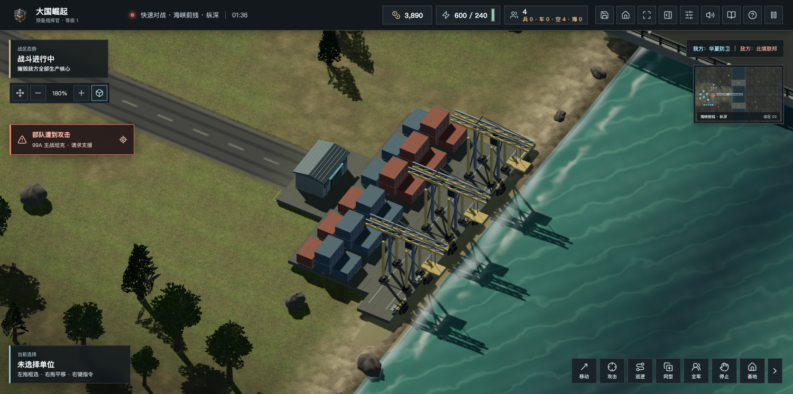
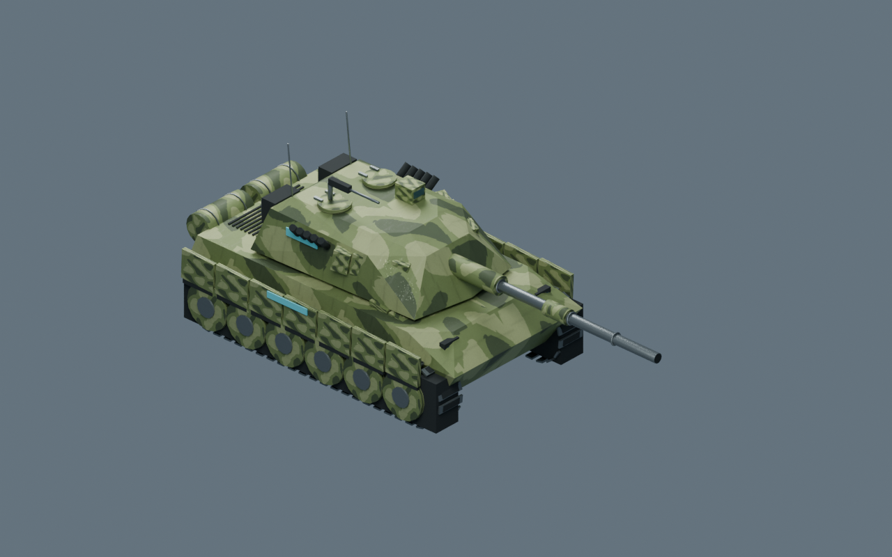

# 3.7.0：程序管弦配乐、现代编制与地面设施

构建：`20261114-orchestral-modern-r1`。日期：2026年11月14日。本轮按玩家反馈修改音乐、机场、码头和模型，并按用户明确选择移除原版现代战区的概念战车与对地固定翼。生产发布结果在文末以实际验收追加。

## 原创采样合成配乐

新增《山海进行曲》：116 BPM、56小节、115.86秒，代码编排号角引子、主题、过渡与再现，使用VSCO 2 Community Edition的24段CC0弦乐、铜管、鼓和钹采样离线合成。不是整支真人乐团实录。采样固定提交、原始WAV及无损FLAC摘要、作者和许可在`assets/third-party/vsco2-selected/`；生成器为`scripts/generate-sampled-orchestra.py`。音源只供离线生成，玩家不下载采样库，也不依赖第三方在线服务。

探索和交战成品各为约160kbps AAC，两者解码均为5,109,517个双声道帧，峰值0.883和0.867，未出现数字削波。`AdaptiveBattleMusic`用两条流式音轨与平滑互补增益切换，不一次展开两段长PCM；漂移超过120毫秒后校时。一个音轨失败或缓冲缓慢时保留已能播放的一轨。交战强度只读取己方最近开火、受击和可知弹道，不读取隐藏敌军状态。静音、暂停、主音量和语音避让仍由原音频总线控制。

默认曲改为新配乐；保留原有静音、音量，以及用户明确选择的《国际歌》等可选曲目。科幻版继续使用独立原创曲目，旧社区配乐及许可不删除。

## 原版现代编制

现代战区移除`elite`、`laser`、`railgun`、`aegis`、`relay`、`strike`、`bomber`、`navalStrike`的生产和图鉴入口。制空机、舰载制空机不再攻击地面、舰艇或停机目标，航母不再拥有抽象对地打击编组，保留实体制空机起降、近程自卫和保障。主战坦克、常规防空、火炮、直升机、电子战、运输及海军仍在。

剧情预置与AI通过统一生成入口使用替代常规机体，不只是隐藏按钮。移除AI为首架攻击机冻结扩建的旧逻辑。旧存档在副本中适配：保留编号、选取与受损比例，弹药不凭空补满，取消的退役生产返还实付资金。原输入存档不修改。科幻战区及独立科幻版保留原机体定义和职责，科幻打包构建已另行检查。

由于现代作战职责改变，双人协议升为7、六方协议升为8，旧网页客户端需要刷新；发布仍须等待房间和对局空闲。

## 程序模型与设施

- 机场改为完整程序模型：两座内部留空的拱形机库、塔台玻璃与窗框、检修梯、油罐、独立跑道和六个实际停机位。停机标记改为斜向引导与止停线，沿用实际调度坐标。铺装逐顶点贴地，不修改地图高度与寻路。
- 码头使用三座原创四腿门架、双轨悬臂、桁架斜撑与双吊索港机，搭配屋面、系泊设施、24个集装箱；游戏内不再等待外部吊机网格覆盖新程序模型。港机与容器共8批、5700三角形，仍在6000预算内。
- 华夏坦克新增程序多色迷彩，不改变炮塔、炮口、履带关节和阵营标识；其余既有合法模型与来源保留。

新设施与坦克均从游戏实际JavaScript几何导入Blender5.3检查，位置无效值0、退化三角形0。Blender检查渲染与真实游戏截图分别标注，不能彼此替代。

## 本地验收

746项回归通过，包括新配乐降级、相位同步和强度来源、现代编制拒绝生产、剧情替换、旧档退款及科幻保留、机场六机位和贴地几何隔离。网页与免安装包构建通过，科幻独立包构建通过。本轮更改职责对应的生产与制空回归已更新，旧武器底层飞弹、弹药与寻路测试仍保留。

浏览器实机：新配乐两轨均成功播放、循环长度一致，相位漂移约5微秒；战况混合强度可达1，静音主增益归零；音效关闭后配器仍能变化。程序机场、逐顶点贴地标记及三座程序港机生效；生产菜单没有退役单位，脚本错误0，图形上下文正常。测试后本机游戏记录逐项恢复。

以下机场与码头图片为游戏引擎受控造景，坦克图为Blender检查渲染，不是连续真人对局。

免安装ZIP已在断网的`file://`环境开局，《山海进行曲》两轨均从内嵌数据播放，长度均为115.914秒；坦克点选及右键移动通过，入门教学推进至2/6，脚本错误0。测试后逐项恢复原有本地记录。

桌面发行的9件Windows、macOS双架构、Linux双架构文件均已从GitHub发行API回读大小与SHA256，下载清单新增本版9件，保留全部历史记录；包体构建通过不等于所有对应硬件已实测。
