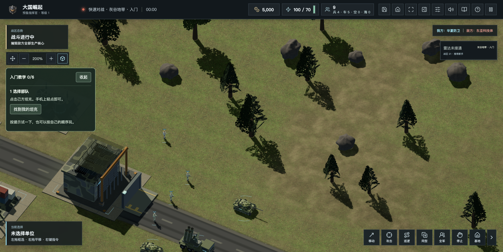
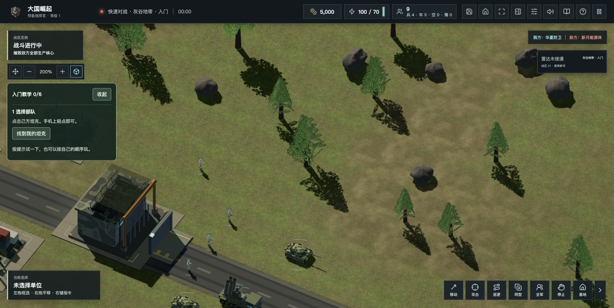
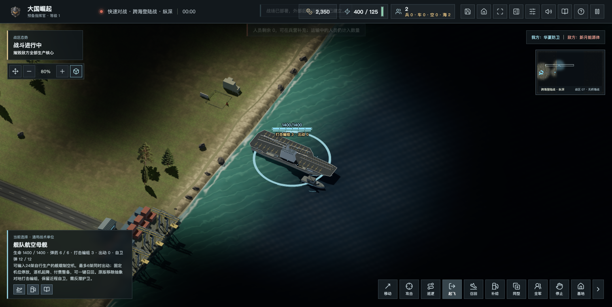

# 3.7.1：树木光照与海面迷雾

日期：2026年11月16日。构建：`20261116-foliage-fog-r1`。

修复玩家提供截图中的树木黑色剪影，以及小地图与主画面海面迷雾不一致。

树冠的深色基础色叠加叶片纹理、背光与阴影后过暗。立体树冠与远景贴片统一使用受纹理约束的小幅散射补光，保留透明叶孔、太阳阴影、双面受光和原有层级切换。没有给整张地图增加曝光，也不删除树影。

海域的逻辑地形高度位于海床，旧迷雾网格贴海床生成，被写入深度的不透明海面遮住；小地图直接合成同一张遮罩，因此看起来不同。新网格沿实际地面、桥面生成，并在有水地图上保持高于海面基准和所有长波振幅之和。海面与反射共用海平面常量，后续调整波幅不会再次让迷雾沉到浪下。纯陆地谷底仍沿原地形，不被强行抬平。

没有修改视野网格、侦察半径、敌军显隐、地图高度和寻路，不需要升级双人7、六方8协议。科幻渠道保持原有发行。

## 本地验收

749项回归通过。桌面及移动预算迷雾网格均高于波峰，高地/桥面贴合，陆地谷底不抬平。

跨海登陆地图的受控实机检查：航母所在格可见，视野外敌舰在逻辑与渲染两层均不可见，更新视觉遮罩前后视野网格逐项一致，脚本错误0。相同帧海域像素对照：己方可见海面开启遮罩为RGB(46,115,100)，关闭为(48,121,105)；未知海面开启为(3,7,9)，关闭为(22,42,54)，主画面已实际合成迷雾。小地图继续复用同一张纹理。

以下为游戏引擎受控场景，树木对照揭开迷雾用于检查材质，不是连续玩家对局。

实机移动舰艇后，旧位置为已探索但不可见，新位置可见，原隐藏敌舰进入新侦察范围后才显示。流畅/精细与战术/立体四种组合均检查通过，图形上下文正常、脚本错误0。近景立体树与战术远景贴片均检查叶色，未关闭太阳阴影。

免安装包已在断网file环境开局；66,731,258字节，SHA256为`f832f565ca9ba292c5786984d79e20d27c3442b80ecfda92f745a73d6a868505`。测试后本地和离线来源的游戏记录均已逐项恢复。

## 发行与生产验收

[GitHub Actions 43783008620](https://github.com/chencheng666/great-powers-rts/actions/runs/43783008620)全部成功：749/749测试、Windows x64、macOS双架构、Linux双架构。9件桌面安装文件大小与SHA256均从发行API回读，另有服务器包及SHA256校验文件。未将构建成功等同于全部系统硬件真机认证。

上海已部署源码`848e8b94e3721c20953e4b7aa6738e67899b4d33`，发布目录`20261116-foliage-fog-final`。服务运行构建`20261116-foliage-fog-r1`，双人7、六方8协议不变。服务器包7,881,742字节，SHA256为`df1f600c33549ed24b55d4e39656257be87d851cfd3c61d7e7da93741085c90b`。

生产网页重复验证舰艇移动、已探索区失去当前视野、未知敌舰隐藏和进入侦察范围后显示，四种画质/视角组合均通过；叶片材质与纹理补光、太阳阴影均实际生效，脚本错误0。点选、移动、攻击及炮塔/履带动画本地实机回归通过。测试后的本地、离线和生产来源游戏记录均逐项恢复。

公网15项页面、脚本、样式、既有配乐摘要与构建一致；服务器289项完整资源校验通过。新ZIP完整下载并核对大小和SHA256，双域下载清单均为3.7.1，保留103条历史下载记录。6个独立科幻、个人站点与其他游戏入口前后摘要不变。

发布前无玩家房间或对局，按原流程备份并原子切换。备份与现库6个SQLite完整性均为ok，各业务表行数未减少，没有用测试数据覆盖玩家数据库。
