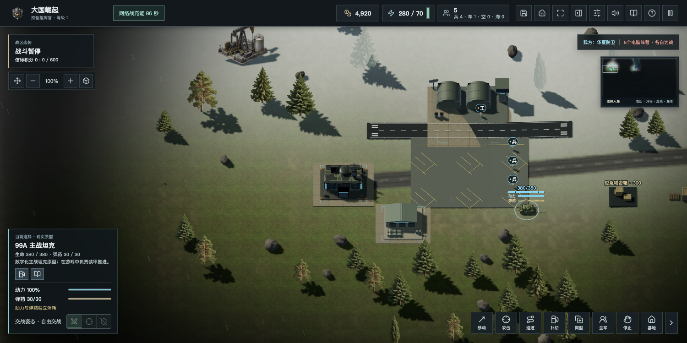
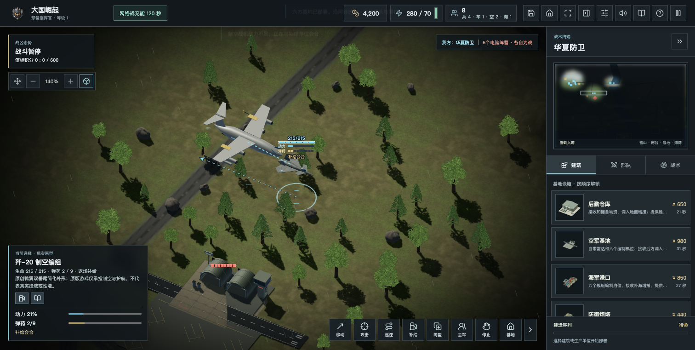

# 3.9.2：动力保障

构建 `20261116-fuel-r1`。“雪岭入海”新单机启用动力规则，动力与弹药独立显示。旧存档继续按原规则游玩，历史战区、独立科幻版及联机不迁移；联机协议仍为7/8。

## 行驶、返场与补给

- 车辆、舰艇按实际行程耗油，飞机还计算滞空消耗；暂停、停机与上舰不耗油。步兵、无人机及经济运输不接入此规则。动力为游戏化百分比，不对应真实装备油箱或航程。
- 低油结合返程距离提前预警并自动返场，完成后继续原任务。陆军与舰艇耗尽停驶，已有弹药仍可使用；空中动力耗尽后有20秒应急下降窗口，期间获得供油或安全着陆可解除，否则记录正常战损，不产生敌方虚假击杀。
- 仓库、机场、港口和航母在有电、停稳及脱战后付费供油。优先恢复动力，达到95%再补弹；基地完整整备会等待动力与保障库存恢复。
- 维修补给车增加220点油料库存；加油机携420点库存，无武装，只供油；补给舰携680点油料及90批弹药，双方停航脱战后先供油再补弹，不能替代维修。库存用尽须付费返场补充。
- 加油机与补给舰从地图边缘增援，占机场/港口编制。可切换自动保障，手动移动优先；供油只面向己方、距离内且符合条件的单位。潜艇接受海上补给时浮航。
- 面板与头顶蓝色动力条、黄色弹药条分开呈现；保障单位另列供油与弹药库存，供油时显示蓝色连接线。

## 电脑与性能

电脑预留850资金用于整补，按预算采购加油机和补给舰，保障力量随编队前出。返场或会合中的部队不会被普通推进覆盖，航母会为低油舰载机返航停航；保障单位受损、缺货或自身低油会返场。保障失效时受援单位重新寻找固定接收点。

模型和材质启动时生成、缓存复用；运行时仅更新姿态、库存与短时特效。返程检查与目标搜索按秒节流，AI保障前出每4秒检查，避免每帧重建资源。

## 验收

- 798项完整回归通过，包含16项动力专项；覆盖新旧规则、实际耗油、暂停、零油停驶、先油后弹、库存扣减、敌我与距离限制、手动优先、应急处置、存档校验、编制与AI采购。
- 浏览器正常申请加油机和补给舰，两者实际从远方抵达并停机/靠泊；受控场景实际完成空中供油。海上驱逐舰从20%动力、0枚弹药补到95%、8枚，补给舰油料680降至605、弹药90降至82，存读档完整保留；脚本错误0，WebGL上下文未丢失。
- 断网file离线包实际开局、保存及界面读档通过；六方、运输经济、矿石0、矿车0、动力规则1。测试后恢复原有存储，其余同源游戏数据逐项一致。
- 五AI按正常资源预算模拟30分钟，共36,001步，每分钟存读档通过；53个单位触发返场、27个单位进入移动保障会合，23个单位曾进入应急下降。四个AI实际采购两类新增保障单位，另一方受战况和资金限制未采购。
- 模拟单步中位7.296毫秒、95分位10.437毫秒、99分位12.028毫秒、最慢66.757毫秒；这是模拟耗时，不代表画面帧率，也不代表所有战局都能避免断供。
- 离线ZIP为66,755,071字节，SHA256：`5eafb5e3968b8d86c17408f9ea3429a56f50c8d48089dd068f8d06a42485ccd0`。

## 正式站验收

2026年11月16日，上海双人/六方服务均返回3.9.2与新构建编号，协议7/8不变。发布包289项资源摘要通过，公网16项页面、清单与脚本样式摘要一致；离线ZIP已完整下载并核对大小和SHA256。

正式站实际新开六方运输经济，矿石及矿车均为0，动力规则1；坦克动力100%、弹药30/30独立显示，保存和界面读档成功，脚本错误0、WebGL上下文未丢失。恢复测试前原有存储，其余同域游戏数据逐项一致。

六个数据库与发布前备份对照，12次完整性检查通过，46张表记录数未减少；保留三个线上其他游戏统计模块、143件历史下载及六处受保护页面。桌面CI的verify及五平台任务全部通过，九件安装包已生成并取得真实大小与SHA256；未逐一在对应硬件实测，Mac未公证、Windows未签名。下载清单新增本版ZIP与九件桌面包，合计153件，正在同步至官网。

[在线试玩](https://www.daguojueqi.site/play/) · [下载中心](https://www.daguojueqi.site/downloads/) · [发行文件](https://github.com/chencheng666/great-powers-rts/releases/tag/v3.9.2) · [结构化验收摘要](./v3.9.2-verification.json)
