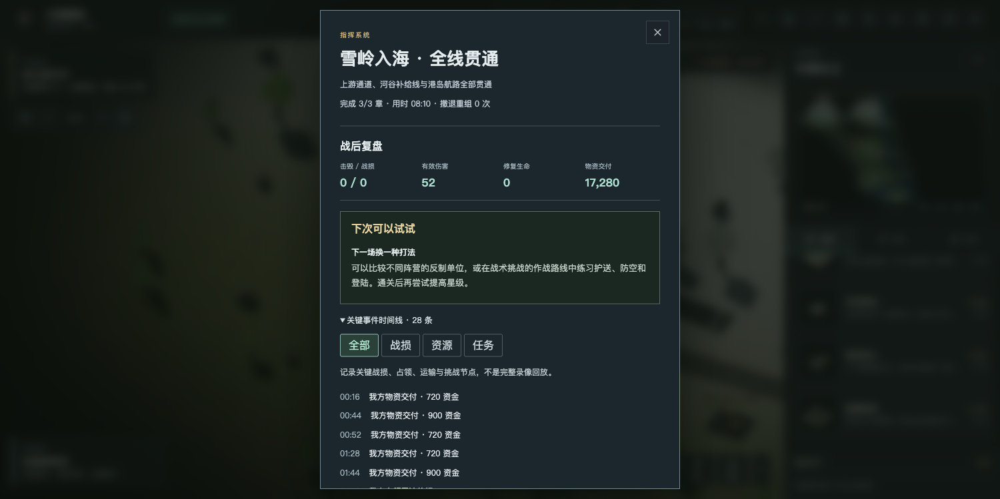
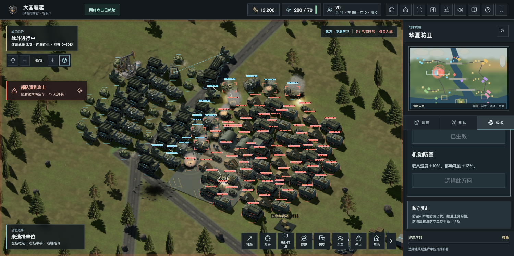

# 4.0.0：雪岭远征

构建 `20261117-command-r1`。本次新增规则适用于“雪岭入海”新单机，包括遭遇战与连续战役。旧存档缺少指挥规则版本时保留原规则，历史地图、科幻版与联网不迁移；双人/六方协议仍为7/8。

## 登陆、指挥与后勤

两栖登陆舰与原坦克登陆舰并存，花费1650资金、52秒调入，占一个港口编制泊位，载重20格（步兵1、车辆4）。舰艇从外海抵达，使用独立动力与16发有限自卫弹药；靠岸停稳后装卸，每0.75秒卸下一批，深海不能卸载。原创程序舰体包括贯通甲板、偏置舰岛与可动艉门；甲板标记仅为外观，不提供舰载机起降服务。

指挥中心可选择两条互斥作战方向之一，花费900资金、准备50秒。完成后锁定，停电或指挥中心损失暂停准备：

| 阵营 | 方向一 | 方向二 |
| --- | --- | --- |
| 华夏 | 阵地保障：基地供油速度+30%，载具速度-5% | 机动防空：载具速度+10%，移动油耗+12% |
| 北境 | 阵地攻坚：坦克与火箭伤害+12%，载具速度-8% | 快速突破：载具速度+12%，伤害-5% |
| 西陆 | 重装维持：移动油耗-20%，伤害-5% | 空地护卫：防空车、战斗机与舰载战斗机伤害+15%，其他伤害-4% |
| 东亚 | 侦察网络：视野+20%，伤害-5% | 精确反甲：坦克与火箭伤害+12%，视野-6% |
| 新月 | 情报控制：视野+15%，基地供油速度-8% | 机动压制：载具速度+12%，移动油耗+18% |

以上为游戏化规则，经济运输不受加成，步兵不增加移动速度；阵营对战平衡仍需持续校准。

“编队推进”先按同层部队集结，再分段前出；陆军跨海需要运输，不能靠该指令跨海。油弹不足先整补，再恢复任务；支援与防空随队保持后距。普通移动、停止和航点可接管指挥。

电脑根据航段、集结、可见空中威胁与整备情况组织推进，为登陆运输预留工程师并派护航；卸载后工程师实际接管目标。侦察向公开地图的未探索出生区展开，实际见过的敌基地保留180秒记忆，目标清空或过期后移除，不读取迷雾中的实时敌军位置。

补给目标按己方和陆海空类型缓存。低油返场机优先于仍在机位等待出场的飞机，已经开始滑行的跑道作业先完成；空中供油按实际230范围判断。缺钱时的海上补弹计时有界，避免长局计时溢出导致存档校验失败。战后可查看返场、应急、动力损失与供油总量。

## 雪岭入海三段连续战役

1. 雪岭开路：接管山口和至少一座油井，驻守30秒。
2. 河谷接力：接管河谷枢纽、芦洲河口和至少两座油井；本阶段交付2160物资并驻守45秒。
3. 向海而生：登陆接管港岛，保有护航舰；本阶段海运交付1800物资并驻守60秒。

三章使用同一张大地图，五个电脑持续行动；资金、部队、油弹、损伤、科技和已占领区域跨章保留。阶段间暂停，继续后按原有规则付费整备。撤退重组保留损失与支出，不免费回血或传送。最近进度与阶段起点分开保存，支持导出完整战局。检查点沿用迷雾按位压缩，兼容旧JSON；空间确实不足时提示导出，不删除其他游戏数据。通关记录在本机独立保存，不混入普通荣誉。

## 画面与性能

延迟创建屏幕外模型并跳过无关动画；湿地积水根据位置、坡度、噪声与原天气时间，联动颜色、粗糙度与法线。模型与材质缓存复用，运行时只更新状态和姿态。

## 本地验收

- 817项完整回归通过，包含19项4.0专项；构建通过。检查覆盖成本与互斥、实际加成、新舰载重/补弹/靠岸、AI登陆与情报边界、联合任务存档、战役阶段与恢复、检查点压缩。
- 受控战役功能场景走通三章，使用真实资金采购、实际移动/登载/卸载/接管/交付；其他席位停止进攻以重复验证流程，不作为自然通关胜率或难度平衡证据。
- 第2章阶段起点界面读取，资金、全部单位编号和已完成作战方向一致；撤退后最近进度增加撤退次数，阶段起点保持原值。
- 正常预算五AI模拟3600秒，共72000步，每分钟存读档。模拟单步中位6.693毫秒、95分位9.782毫秒、99分位11.490毫秒；这不是画面帧率。五AI均研发作战方向，实际采购各自需要的陆海空及保障兵种，其中两席采购两栖登陆舰；仍有断供损失，不宣称能避免所有动力耗尽。

- 断网file离线版实际开局、保存、退出并通过界面恢复连续战役；检查点压缩至46,219字符。脚本错误0，WebGL上下文未丢失；测试后恢复原存储，其余同源游戏数据一致。
- 140单位受控同屏混战执行300帧同步渲染负载检查，渲染中位8.1毫秒、95分位58.4毫秒，模拟中位12.2毫秒；图形程序失败0、脚本错误0、上下文未丢失。宿主存在后台帧调度降频，此负载结果不能换算真实FPS；高密度交战仍有帧耗时尖峰，未承诺所有设备流畅。返回主界面后几何从335回落至34、纹理从47回落至5，渲染器已释放。

## 发布状态

本地验收后同步官网、上海双人/六方服务、离线包与桌面发行；实际生产回读和桌面CI结果将在完成后补充。独立商店版本不随网页更新自动升级。

[在线试玩](https://www.daguojueqi.site/play/) · [下载中心](https://www.daguojueqi.site/downloads/) · [发行文件](https://github.com/chencheng666/great-powers-rts/releases/tag/v4.0.0) · [结构化验收摘要](./v4.0.0-verification.json)
