# 从浏览器到桌面：我和 Codex 把《大国崛起》做成了可安装的开源 RTS

2026-10-12 · 陈成

上篇文章里，我还在讨论：这个浏览器里的即时战略游戏，下一步应该继续免安装，还是做成桌面应用？Electron 和 Tauri 又该怎么选？

这次，先把一个能实际打开的版本交出来。《大国崛起》桌面实验版 v0.9.1 采用 Tauri，已经生成 Mac、Windows 和 Linux 安装包。我的这台 Apple Silicon Mac 上，三维单机战场、保存与恢复、原生全屏已经实际跑通。

感谢 CAI 和一直认真试玩、提建议的朋友。你们让我更在意一件事：游戏不只是展示一张好看的截图，而是能方便打开、玩到一半能保存、出了问题能说清楚的作品。我继续和 Codex 一起开发，也继续把完成的和没完成的分别写明白。

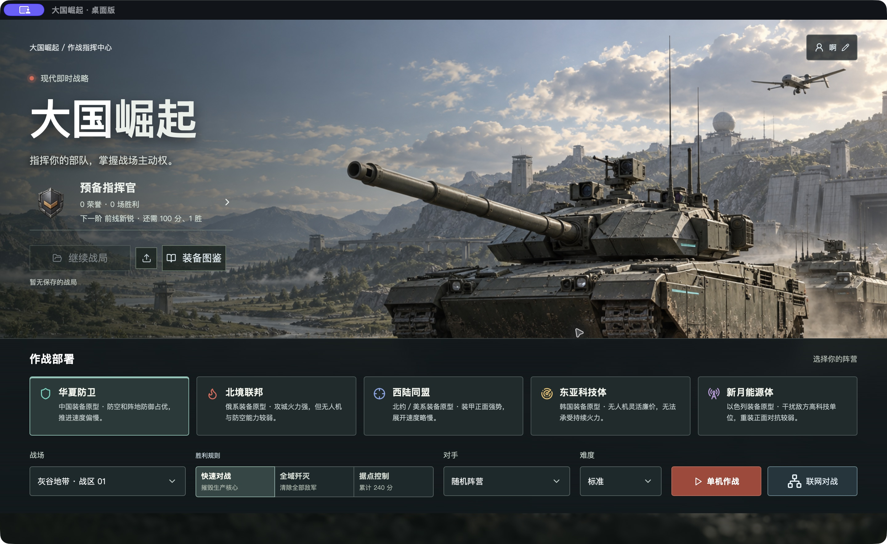

*真实原生桌面截图｜Apple Silicon Mac 测试副本的首页，游戏从内嵌资源入口启动；不是概念设计图。*

## 第一件事：把战场装进电脑里

网页版会保留，分享一个地址就能试玩，这一点很方便。桌面版则提供另一种打开方式：安装后，从应用图标进入战场，游戏本体、模型和素材随应用一起带到电脑里。玩家启动单机不需要配置 Vite 或 Node 开发服务。

Tauri 使用系统 WebView 显示现有三维战场，再通过 Rust 接入窗口与文件能力。这次没有重新写一套游戏规则，也没有把“换了一个壳”说成性能翻倍。部队仿真、渲染、显卡和系统驱动仍然决定实际体验。

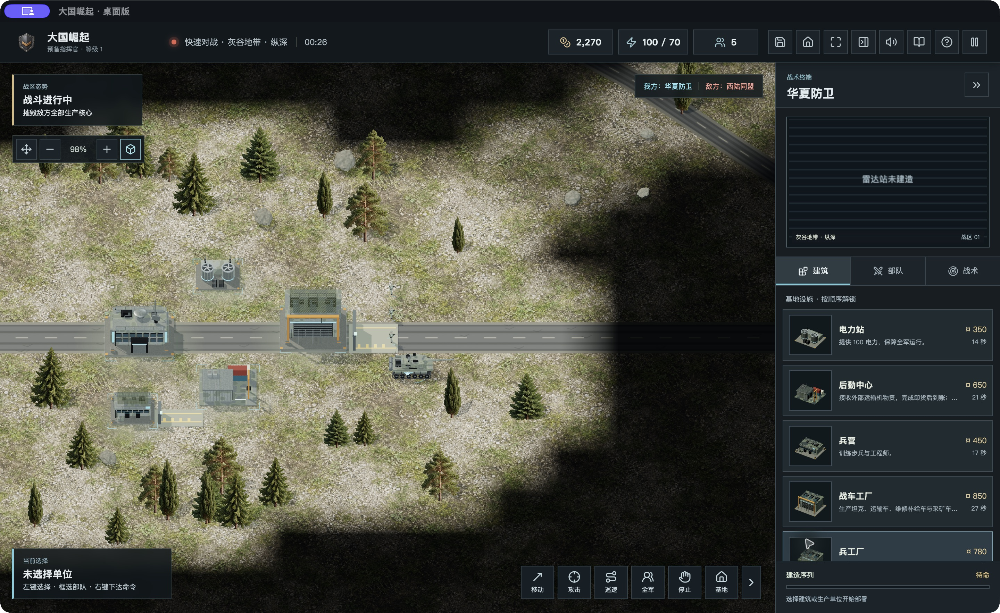

*真实原生桌面截图｜华夏防卫单机战场，建筑、部队、运输机和迷雾来自实际运行版本。已确认使用内嵌资源，但尚未进行系统断网切换测试。*

《大国崛起》仍是受经典即时战略启发的原创非官方项目，不是官方《红色警戒》续作。装备参考公开原型，数值服务于游戏平衡，不代表现实军事性能。

## 第二件事：打一半，能停下来再继续

这台 Mac 上已经实际进入和退出原生全屏。手动保存之后，也能从存档列表恢复到同一个战局时刻，自动存档和手动存档分别保留。

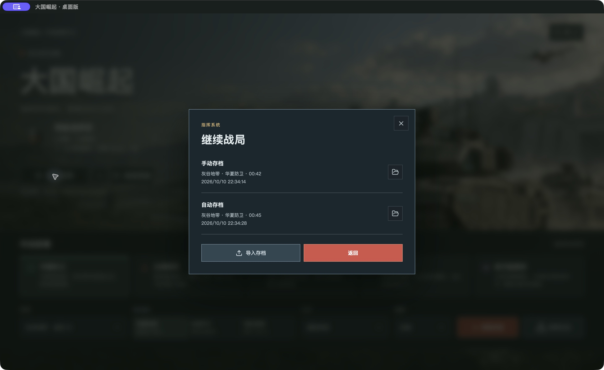

*真实原生桌面截图｜手动存档 00:42、自动存档 00:45；已读取手动存档并恢复战局。*

桌面版还接入了系统文件导入、导出和应用数据目录备份。10 月 11 日补测时，我从原生保存对话框导出测试 JSON，再通过原生文件选择器导入，成功恢复到灰谷地带 00:49、华夏防卫、资金 2,270，与导出前一致。此前因锁屏中断的文件往返流程，这次已在 Mac 测试副本验收通过；其他系统仍待实机验证。

## 第三件事：战车细节继续改，规则问题也要修

安装包之外，战场本身也继续打磨。99A 后部补了装饰油桶、固定带和支架；待机时炮管轻微抬起，移动和交战时回到对应姿态。这个处理只用于对应装备，没有一股脑套给所有坦克。

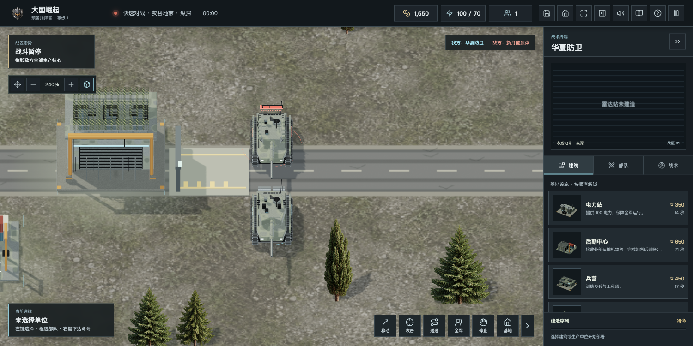

*真实浏览器游戏截图｜近景观察后部装饰油桶、支架与固定细节。*


*真实浏览器游戏截图｜待机时炮口轻微抬起。*

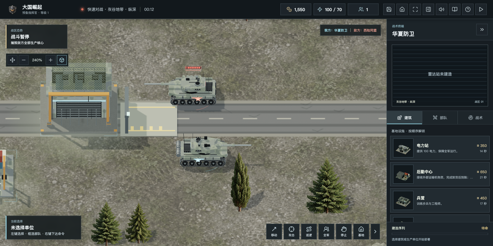

*真实浏览器游戏截图｜交战时恢复瞄准与后坐动作。*

人物武器会随目标调整俯仰，开火后短暂保持瞄准；坦克转向时，两侧履带运动也会变化。桥面坦克与桥下舰船穿过桥面直接互射的问题也修正了。移动速度保持原设定，平衡调整还需要更长对局的数据。

## 第四件事：近处看细节，远处看战场

远景步兵采用更轻的模型，近景再保留细节。此前固定 240 单位的浏览器受控场景中，三角形减少约 46.8%，GPU 中位耗时减少约 31.2%。不过整体交战帧率没有明显提升，仿真和绘制调用仍需优化。

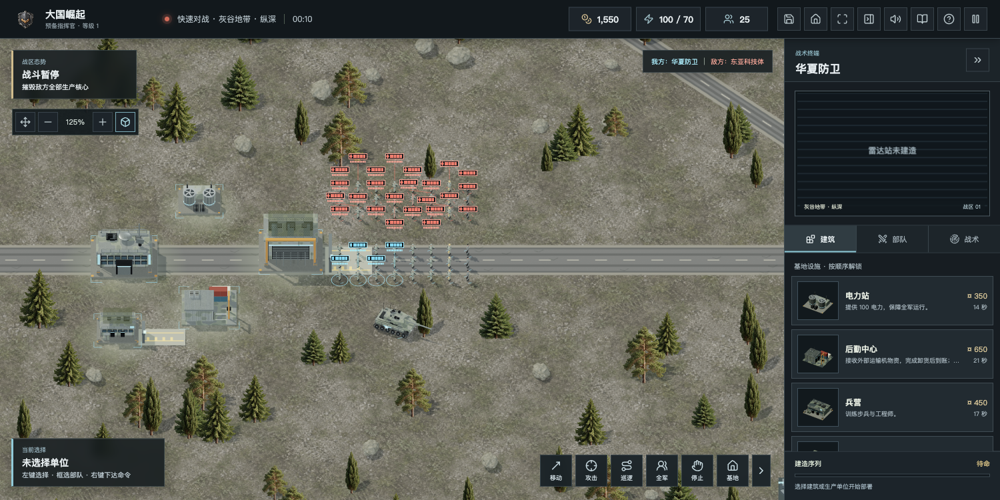

*真实浏览器验收截图｜固定布局和战略镜头，优化前。*

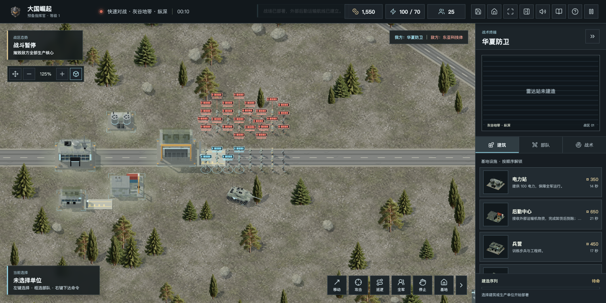

*真实浏览器验收截图｜相同布局和镜头，优化后。*

这组记录说明某一部分成本降低了，不能推广成所有电脑上的帧率承诺，更不能把浏览器数据当成每个平台的桌面实测结果。

## 第五件事：桌面也能和浏览器一起联网了

上一版桌面入口暂未开放，原因是 HTTP 页面被 macOS 的 ATS 阻止。这次采用公开 IP 的可信证书，游戏新增独立 HTTPS 8443 入口，WebSocket 同时升级为 WSS；既有 443 服务和网页 HTTP 入口保留，没有关闭 ATS 或忽略证书验证。

https://43.135.186.21:8443/

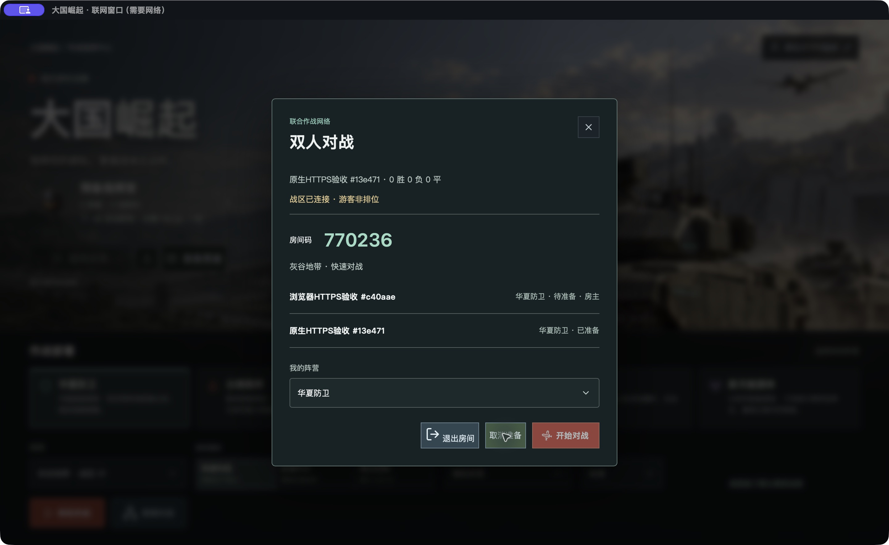

*真实原生窗口截图｜0.9.1 Mac 测试副本进入 HTTPS 大厅，与 Ego Lite 浏览器的独立身份加入同一房间并准备。两名客户端都运行在同一台 Mac，不是两台物理设备的测试。*

双方准备后，浏览器房主开局，Mac 独立联网窗口实际进入三维战局；在原生窗口点击电力站，服务端接收命令并返回建造队列。

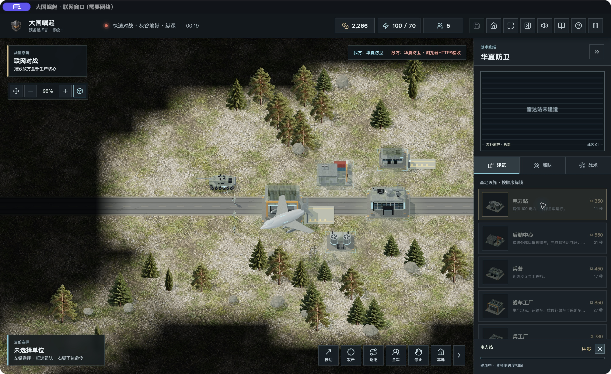

*真实原生窗口截图｜对手为浏览器测试身份，联网战局计时推进，电力站正在建造。没有把本地单机画面当成联网。*

另用同一 Mac 上两个独立 Node 会话完成了可信 TLS、WSS、双席位建房加入、双方准备开局、第二席位命令和快照、断线暂停、同一战局重连恢复。随后补做了原生 UI 重连：关闭专用联网窗口，浏览器显示“等待对手重连”；重开原生联网窗口后自动恢复原房间战局，资金仍为 2,990、计时继续推进。此测试是窗口关闭重开，并非断开整台电脑网络，也不能代表所有客户端或所有运营商环境。

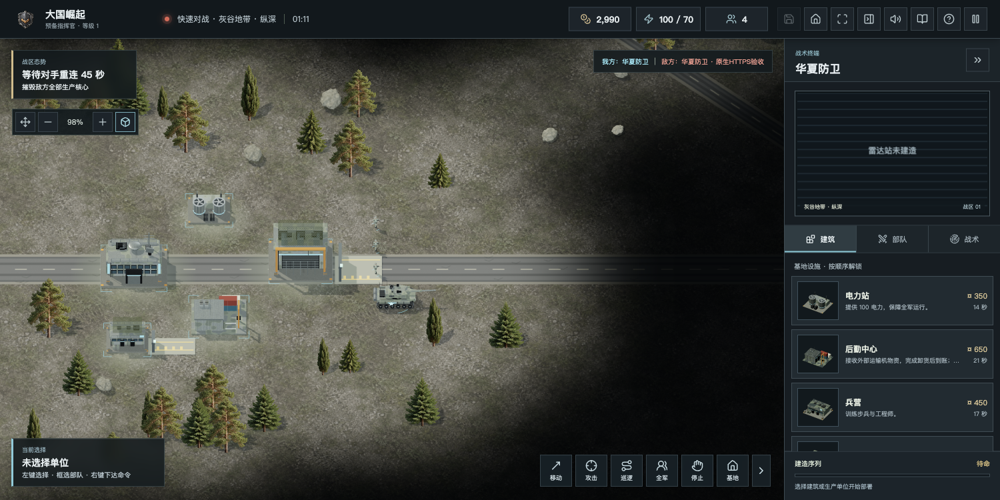

*真实浏览器截图｜原生联网窗口关闭后，对手等待重连，战局暂停。*

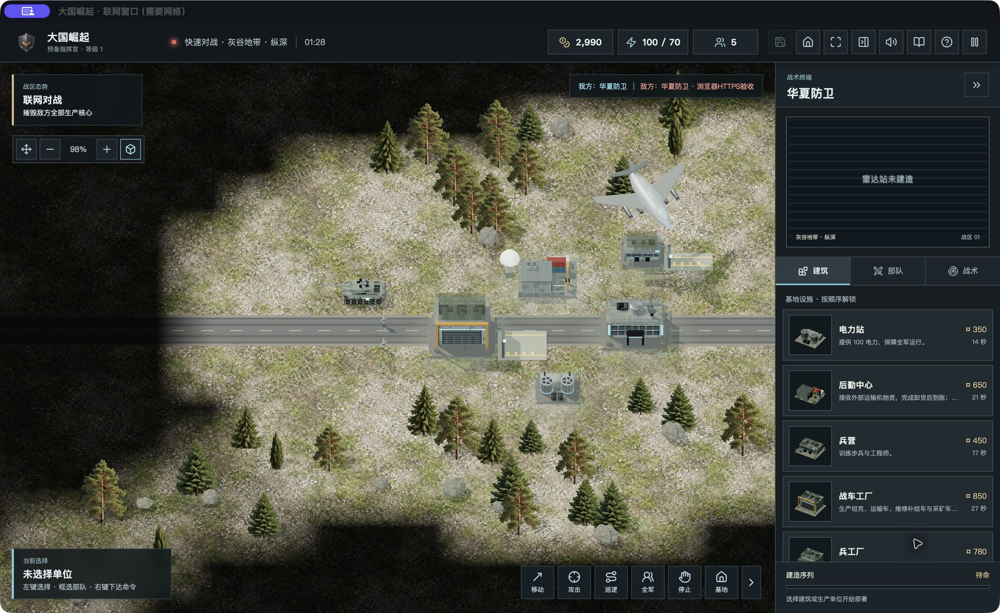

*真实原生截图｜重开联网窗口自动恢复同一战局，资金 2,990、计时继续推进；之后已退出并清理测试房间。*

证书由 Let's Encrypt 签发，SAN 是公开 IP 43.135.186.21，当前有效期为 2026-10-12 01:10:15 至 2026-10-18 17:10:14 UTC。短期证书必须可靠续期：服务器已设置每日两次检查、成功后重载代理，模拟续期通过。不提交联系邮箱，证书私钥留在服务器，没有随游戏包或源码公开。

远程联网页面不授予本地存档、文件选择等原生能力；权限限定在本地主窗口，原生命令也再次检查调用窗口与来源。联网窗口仅允许跳转到配置的同一 HTTPS 来源。网页与本地单机存档保持独立。

## Mac、Windows、Linux：构建成功，还需要实机继续验证

0.9.1 的五个 CI 目标都已成功，本机 Mac app/DMG 也已构建。构建成功和实机体验仍分别记录：下面区分“有安装包”和“已经在那台机器上玩过”，欢迎带着具体设备来帮忙测试。

| 平台 | 当前实际结果 |
| --- | --- |
| Mac Apple Silicon | 本机 app / DMG 构建通过；三维单机、保存恢复、原生全屏已实测；原生文件导出再导入已实测 |
| Mac Intel | CI 构建成功，未实机验证 |
| Windows x64 | CI 构建成功，未实机验证 |
| Linux x64 / ARM64 | CI 构建成功，未实机验证；需要 WebKitGTK 4.1、GTK3 和支持 WebGL2 的图形驱动 |
| 银河麒麟桌面 V10 / 统信 UOS 桌面 V20 | 具体 SP、更新版本和硬件未实测；x86_64 / aarch64 为候选目标，需核对依赖，不能保证可安装 |
| 龙芯 / 申威 | 未提供支持 |

上一期有朋友反馈国产系统浏览器版可以玩，那是浏览器试玩经验，不能直接当成这次 Tauri 安装包的兼容认证。Linux 构建基于 Ubuntu 22.04 环境；不同发行版的依赖和驱动还要逐项核对，应用商店也尚未上架。

macOS 实验包采用 ad-hoc 签名，未经过 Apple 公证；Windows 安装器未代码签名。请核对架构与 SHA256，不要关闭系统安全保护。本次网页回归 284/284、Rust 3/3 通过，网页构建通过；测试帮助守住规则，仍代替不了真实试玩。

## 下载地址放出来，欢迎继续一起改

v0.9.1 的九项桌面资产已在 GitHub 预发行页公开，v0.9.0 历史版本也保留，包含 Mac 两种架构的 DMG / app 压缩包、Windows x64 安装器、Linux 两种架构的 DEB / AppImage。旧服务器升级归档不在本次公开范围内。

桌面实验版 v0.9.1 下载与逐文件校验值：

https://github.com/chencheng666/great-powers-rts/releases/tag/desktop-v0.9.1

历史 v0.9.0：

https://github.com/chencheng666/great-powers-rts/releases/tag/desktop-v0.9.0

现有服务器下载中心现有 20 项：两个 Mac ARM64 本地包、九个 GitHub 0.9.1 新版直链、九个 0.9.0 历史直链，分别标注版本与来源。九个新版 GitHub 文件的匿名 HEAD 全部返回 200，大小与公开发行 API 一致；SHA256 来自 GitHub 公开发行元数据，并未把 HEAD 验证说成所有平台整包下载验收。

https://43.135.186.21:8443/downloads/

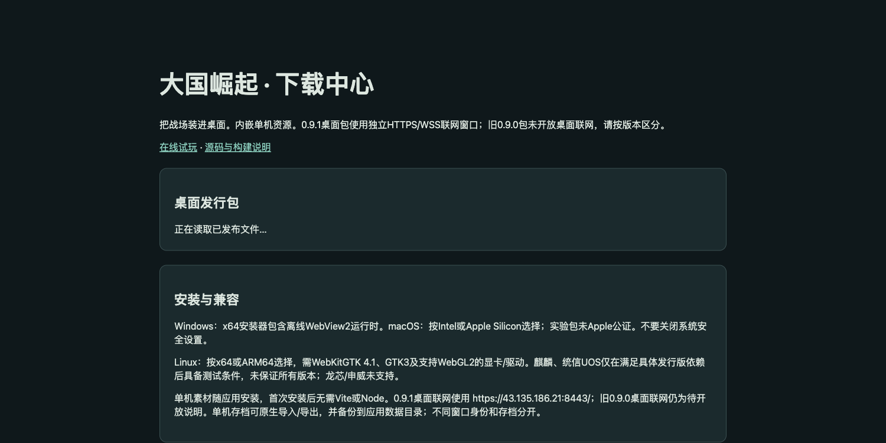

*真实浏览器截图｜服务器已列出 Mac Apple Silicon 新旧两版安装器及历史 GitHub 直链，大小、SHA256 与适用范围分别标明，不代表所有平台已镜像到服务器。*

Mac ARM64 0.9.1 本机构建包直接地址：

https://43.135.186.21:8443/downloads/packages/Great-Powers_0.9.0_aarch64.dmg

大小：45,531,609 字节。SHA256：

```text
d6f7e6cd40feddf9b2979e53bc5a059d67d6c9d8394e88cc8472d322ed5c32cb
```

该服务器包的匿名 HEAD 返回 200；服务器通过可信 HTTPS 完整读取的哈希一致，外部 Mac 的完整匿名 GET 大小与 SHA256 也通过。服务器包和 GitHub CI 包来自不同构建环境，大小与哈希不同，请按各自下载来源核对，不能混用校验值。测试服务器仍在腾讯云硅谷，不称为国内下载站。

网页试玩 / 双人联网测试：

http://43.135.186.21:8088/

桌面版源码分支：

https://github.com/chencheng666/great-powers-rts/tree/codex/desktop-v090

0.9.1 五平台实际构建记录（全部成功）：

https://github.com/chencheng666/great-powers-rts/actions/runs/38195369859

问题与建议：

https://github.com/chencheng666/great-powers-rts/issues

欢迎告诉我你的系统版本、处理器架构、显卡与驱动、地图、阵营和复现步骤，有截图或存档更好。会代码、建模、配音和平衡测试的朋友，也欢迎通过 Issue 和 PR 一起共建，素材请说明来源与许可。

下一轮继续做其他平台文件操作验收、更多网络环境的 UI 重连验收、不同系统实机测试，以及战场细节与长局稳定性。先把今天能玩的做好，再把下一步做到。谢谢每个愿意认真打开游戏、指出问题的朋友。

说明：本文为公众号 Markdown 草稿，尚未发布公众号；开发与整理使用 Codex 辅助。十三张配图均为真实运行截图，原生桌面与浏览器来源已分别标明。
