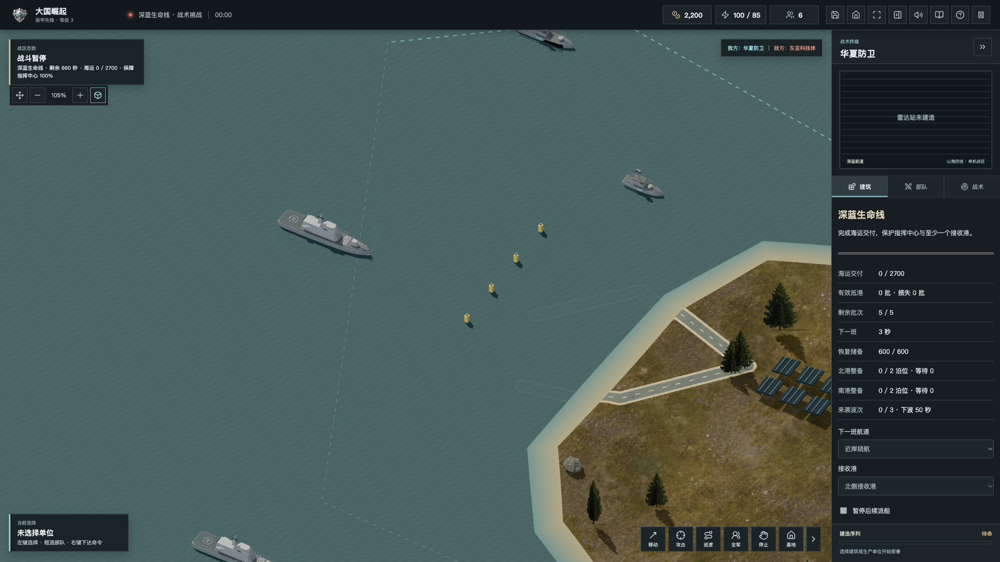
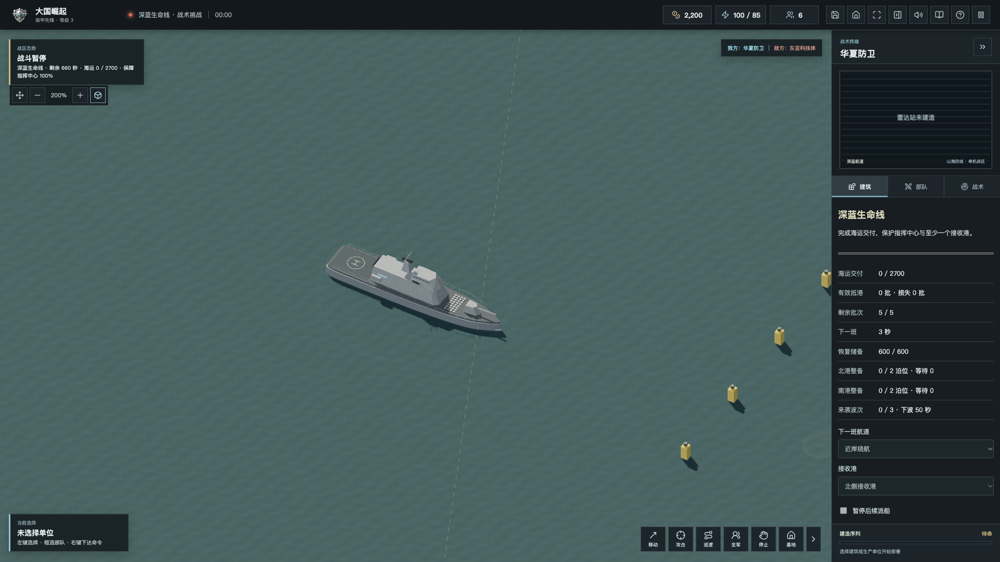
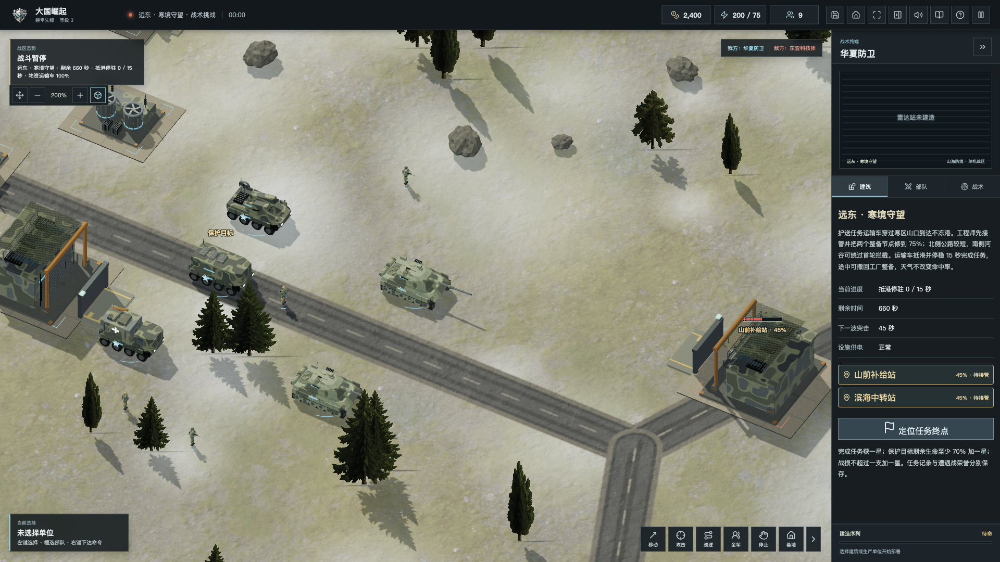
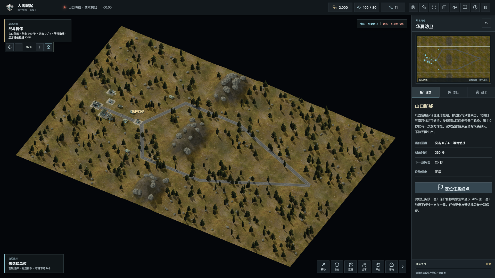
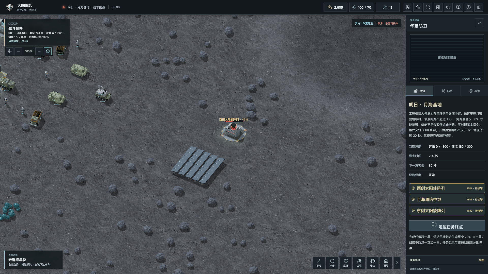

# 从海峡到月海！大国崛起2.0，九大战区与一条不能断的补给线

2026-10-24 · 陈成

大家好，我是陈成。《大国崛起》2.0「山海防线」已经上线。这次想先带大家看游戏：海面上的护航编队、山口里的装甲部队，以及走向月面的工程机器人。

一路从最初的网页试玩做过来，玩家最常追问的，是部队能不能更好指挥、运输有没有意义、地图能不能有不同的打法。这一版，我把这些问题放进了九个独立单机任务里。



*深蓝生命线｜舰队、岛礁与双港航道。本文五张图片为2.0引擎受控实机，拍摄于10月22日；部分暂停并揭开迷雾，用于检查模型和地形，不是连续真人试玩录像。*

## 从海峡到月海，九个战区，九种作战取舍

2.0的九大战区，是可以分别选择、重试、保存和复盘的单机挑战。它们有各自的任务目标与评价，再加上五项原有训练，目前共有14项挑战。

「海峡风云」要先登陆修复前哨，再接收物资，最后接管纵深枢纽并驻守。前哨一旦中断，任务阶段会回退；向前推进之前，要想清楚后方由谁保护。

「列岛守望」把战场放在没有陆桥相连的五座岛之间。登陆舰分批卸载，工程师接通能源、港务与通信；侧翼机场可以接管、修复，提供一次战机增援和后续整备，雷达则让你看得更远。

「深蓝生命线」把海运直接变成任务目标：最多五批运输，累计交付2700物资。航道和接收港可以调整，但物资必须有效抵港才结算。护航舰挡住卸货点，也会妨碍运输，舰队需要给货船留路。

## 海上有舰队，岸上有需要照顾的装甲



*国产驱逐舰近景｜舰体、甲板与武器轮廓经过本版精修。装备是游戏化简化模型，不代表现实军事性能。*

这一版精修了国产坦克、驱逐舰和人员，也加入了许可清晰的社区坦克、F-22、港口吊机和地面材质。源码与离线包保留素材署名和原许可。

模型只是其中一部分。陆军要考虑弹药、维修和补给车，飞机需要返场整备，舰艇与潜艇需要返港。强力装备也要有侦察与保障，单一兵种很难包办所有事情。



*寒境守望｜国产坦克、运输车、支援车辆与人员。右侧任务要求修复中转站，并护送运输车抵达不冻港。*

「远东·寒境守望」里，北侧公路更短，南侧河谷能绕过首轮拦截。你既要选路线，也要派工程师恢复两个整备节点，让运输车安全抵港并停稳。

「归航行动」则把胜利目标换成救人。登陆舰可往返接送四批人员，至少撤离三批；同一批人员反复上下船不会重复计数。留下舰队保护航路、让运输船多跑一趟，可能比追击残敌更有价值。

## 山口防线：用有限部队，守住两条通道



*山口防线全景｜山脊把南北通道分开。此图暂停并展开地图，用于展示路线；不是普通迷雾下玩家能同时看到的范围。*

「山口防线」使用固定编队，四轮突击、一次友军增援，不能无限生产。北山口和南河谷都能通行，你需要留预备队，判断哪边先承压。受损单位回西侧整备厂轮换，再回前线接防。

「钢铁走廊」考验接管后的恢复：电站、铁路货场和两座加工厂要互相配合。厂区受损会降低产出，断电或被争夺会停产；每厂产出有上限，反复易主也不能刷出无限资源。铁路目前是场景和物流节点，列车调度还没有实现。

「战略警戒」要求保护分散的预警节点，让网络持续工作，并反制来袭威胁。这是一项关闭核规则的常规保护任务；把保障链保持住，比清掉地图上所有建筑更重要。

## 走向月海：能源、采矿和中继网络



*明日·月海基地｜太阳能阵列、通信中继与月表编队，使用独立的科幻任务规则。*

「明日·月海基地」里，工程机器人修复太阳能与通信节点，采矿车就地取材。节点需要足够完整、间距合适，储能不足时远端链路会暂停；基本指令依然可用，你还有机会恢复网络。

任务要求累计交付1800矿物，并让全网与不少于120储能保持30秒。它把地面战里的补给保障，换成月面的能源与通信问题。月面是游戏的科幻演绎，不是现实环境模拟。

## 想先玩一局，可以这样开始

电脑浏览器打开官网，进入单机，先选一个任务试试。左键选择或框选部队，右键移动与下令；Shift加右键可排连续航点，Ctrl加数字保存编队，数字键再次选择。遇到不熟悉的装备，可以打开三维图鉴。

遭遇战保留五阵营、三档AI和三种胜利规则，也有双人联机。六方入口仍是自由混战实验，每席40单位。九大战区目前只支持独立单机，尚未接入合作或3v3。下载页提供免安装离线包及桌面安装包，离线包完整解压后打开PLAY.html即可。

大军团显示采用共享几何、材质和实例化绘制，远处模型减少细节。现有M1 Pro短时受控采样中，240单位标准画质陆战帧耗时P95为32.5ms，陆海混编为43.6ms；这不等于所有电脑都能稳定60帧，长局和更多硬件还需要继续验证。网页首次加载要下载模型与材质，慢速连接下建议先用完整离线包。

## 留一点篇幅，说说它怎样运行

客户端使用JavaScript、Three.js和Vite，Node.js与WebSocket承载联机，SQLite保存服务端用户和战绩，桌面版使用Tauri。单机和服务端复用模拟规则；联机时客户端提交意图，服务端核验归属、坐标与状态，再计算资源、命中和胜负。

下面这段来自server/commands.mjs：先筛选当前席位真正拥有、仍存活的单位，再把有效选择交给模拟层。玩家发来一个单位编号，并不意味着能指挥它。

```javascript
const own = id => {
  const e = game.getEntity(id);
  return e?.owner === side && e.hp > 0 ? e : null;
};
const selected = Array.isArray(message.selected)
  && message.selected.length <= 120
  ? [...new Set(message.selected.filter(
      id => Number.isSafeInteger(id) && own(id)
    ))]
  : [];
```

## 感谢一起把游戏往前推的人

特别感谢玩家CAI持续试玩、留言和整理测试反馈，也谢谢每一位提出问题的朋友。运输、港口、维修、避让和操作上的具体建议，让这个项目逐渐有了自己的玩法。

欢迎继续共建：反馈卡住的位置时，带上版本、地图、操作步骤、浏览器与设备；如果方便，再附截图或导出的存档。平衡建议也可以写清双方阵营、编组和实际交战过程。开发者可以参与寻路、性能、界面与测试；美术贡献请附上来源和授权。

## 3.0想走向哪里？以下都是计划

第一步，继续打磨基础体验：首次加载、寻路与避让、大军团P95帧耗时、长局和弱网稳定性，再补更多硬件实测。画面再丰富，也要先让一局游戏顺畅结束。

第二步，把独立任务逐步串成连续战役，让上一关的选择、损失和保障状况影响下一关。第三步，探索合作任务和更明确的多人分组，同时用真人对战记录调整平衡。

跨设备档案、平台体验和更完整的录像回放，也在后续考虑范围。以上是方向，尚未完成，也没有承诺上线日期；具体先做哪一项，会结合试玩反馈和验证成本来决定。

2.0先把九个战区交到大家手里。欢迎来玩一局，看看哪条补给线最难守、哪一关最需要改，再一起把下一版做得更好。

[网页试玩](https://www.daguojueqi.site/play/)

[下载中心](https://www.daguojueqi.site/downloads/)

[源码与发行](https://github.com/chencheng666/great-powers-rts)

[问题反馈](https://github.com/chencheng666/great-powers-rts/issues)
